<!--
HOW THIS FILE IS USED
This file is the single source of the report text. docs/build_report_docx.py reads it and writes
docs/Project_Report.docx on top of the official course template. Headings follow the template
chapters. Citations are written as [@key] and are numbered in order of first use; the matching
entries are listed under REFERENCES as "@key: text". Square-bracket PENDING markers mark a result or
confirmation that is still missing and must be replaced before submission. Source tags such as
(nb02, cell 8) point to the saved notebook or file the number came from (key in Appendix A).
-->

# ACKNOWLEDGEMENT

We thank Prof. Anantha Rao, our faculty supervisor for the Advanced Data Science course, for guiding the project through its stages and for the clear expectations in the project guidelines. [PENDING team to confirm: supervisor named as written here.]

We are grateful to the School of Engineering and Technology, BML Munjal University, for the laboratory sessions and the freedom to choose a real decision problem.

The project rests on public data. We thank the New York City Taxi and Limousine Commission for the trip records and zone files, the National Centers for Environmental Information (NOAA) for the hourly weather observations, and the US Office of Personnel Management for the federal holiday calendar.

Finally, we thank each other: the work was split across data engineering, analysis, forecasting, simulation and verification, and it only fits together because every part was checked by someone else.

# ABSTRACT

A robotaxi company has no drivers, so it must decide where every empty car waits; each idle hour and empty mile is a direct cost. This project asks how an operator planning a New York City launch should choose its launch area, how many cars should wait in each zone every hour, and whether a freed car should stay or drive empty to a busier zone. Total profit is the main measure.

We use 2024 New York City Uber and Lyft trips as a stand-in for robotaxi demand. A Spark pipeline turned 259.9 million trip records, weather and holidays into 2,505,864 zone-hour rows for 263 zones. Demand differs strongly across zones and hours (H1, supported within an exploratory design). A seven-day-ahead forecast ties a plain four-week mean (error 18.93 against 19.21). A 15-minute fleet simulator with one common price compares placement plans for 25, 50 and 100 cars on 57 test days, with every setting frozen on October days first.

Results are mixed. Placing cars by expected profit clearly beat random (+17% to +29%) and equal placement (+1% to +21%). But the proxy-chosen launch areas did not beat a fixed Manhattan plus Downtown Brooklyn area (H2 not supported), although a post hoc area searched with the simulator did (exploratory). Profit placement beat ride-count placement only for the smallest fleet (H3 not supported), forecast-based placement was no better than copying last week (H4 inconclusive) and moving free cars did not pay (H5 not supported). Post hoc, staying put beat hourly re-placement. We recommend starting from the dense Manhattan core, using simple demand-based rules, rebalancing rarely and calibrating prices with real data. Findings are associations in a simulation on a proxy of robotaxi demand, on previously examined days, not a pristine test.

**Keywords:** robotaxi, fleet placement, demand forecasting, New York City, ride-hailing, gradient boosting, fleet simulation, launch-area optimisation, hypothesis testing, drift monitoring

# TABLE OF CONTENTS

[[TOC]]

# LIST OF FIGURES

[[LIST_OF_FIGURES]]

# LIST OF TABLES

[[LIST_OF_TABLES]]

# LIST OF ABBREVIATIONS

| Abbreviation | Full form |
|---|---|
| ADS | Advanced Data Science |
| API | Application Programming Interface |
| BADIR | Business question, Analysis plan, Data collection, Insights, Recommendations |
| CBD | Central Business District |
| DST | Daylight saving time |
| EDA | Exploratory Data Analysis |
| ETL | Extract, Transform, Load |
| H1 to H5 | Hypotheses 1 to 5 |
| HGB | Histogram-based gradient boosting (scikit-learn `HistGradientBoostingRegressor`) |
| HVFHV | High-Volume For-Hire Vehicle (Uber and Lyft style services) |
| IEEE | Institute of Electrical and Electronics Engineers (reference style) |
| KPI | Key Performance Indicator |
| LCD | Local Climatological Data |
| MAE | Mean Absolute Error |
| NCEI | National Centers for Environmental Information |
| NOAA | National Oceanic and Atmospheric Administration |
| NYC | New York City |
| OD | Origin-destination (a pair of pickup and drop-off zones) |
| OPM | US Office of Personnel Management |
| RMSE | Root Mean Squared Error |
| SHAP | SHapley Additive exPlanations |
| SSOT | Single Source of Truth |
| TLC | NYC Taxi and Limousine Commission |
| UTC | Coordinated Universal Time |
| WAPE | Weighted Absolute Percentage Error (total absolute error divided by total actual demand) |

# CHAPTER 1: INTRODUCTION

## 1.1 Background and context

A taxi company with human drivers can let drivers roam and look for riders. A robotaxi company cannot. It owns the cars, so it must decide where each empty car waits. A car that waits in the wrong place earns nothing, yet it still costs money for the empty miles it drives to the next customer and for the hours it sits idle.

The same operator must also pick a launch area, a connected set of zones where the service will run, before it has any customers of its own. Both choices depend on how demand varies across the city and across the day.

New York City is a good test bed because its Taxi and Limousine Commission (TLC) publishes one record for every high-volume for-hire trip, with pickup and drop-off zone and time [@tlc_trips]. These records cover Uber and Lyft, the closest large-scale proxy for app-based robotaxi demand that is publicly available.

## 1.2 Overview of the selected domain

The project sits in urban mobility and fleet operations. Three ideas from this domain matter here:

- **Demand forecasting.** Predicting how many ride requests will start in each zone in each hour.
- **Fleet placement (also called repositioning or rebalancing).** Moving or parking idle vehicles so they are near expected demand.
- **Launch-area design.** Choosing which part of the city to serve first.

In this report, a *request* means an eligible completed-trip request in the TLC data. Requests that were never served are not recorded, so the counts are a proxy for demand, not total market demand. Chapter 4 reviews related work in each of these three areas.

## 1.3 Motivation and significance

Every idle car-hour and every empty mile is a direct cost to a robotaxi operator [@preSubmission]. Placement quality therefore shows up directly in profit. It is also a service question: a plan that only chases the busiest zones may leave quiet zones with very little service. For that reason the project reports a service gap between low-demand and high-demand zones next to profit.

The project is also a full data science lifecycle exercise, as the course requires [@handout; @guidelines]: problem framing, data engineering at scale, hypothesis testing, forecasting with explanation, simulation, optimisation and drift monitoring.

## 1.4 Stakeholders and intended beneficiaries

The primary stakeholder is the **fleet operations team of a robotaxi operator** (for example a company such as Waymo) planning a possible New York City launch. Riders and the city regulator are secondary stakeholders [@preSubmission; @decisions].

## 1.5 Project objectives

1. Build one trustworthy, documented dataset of hourly demand per taxi zone from public sources.
2. Show how demand varies across zones, hours, weather and holidays.
3. Build a demand forecast that uses only information available at least seven days earlier, and compare it with simple history.
4. Build a fleet simulator that turns a placement plan into profit, with one common price and explicit costs.
5. Choose a launch area from data and compare it with a fixed Manhattan plus Downtown Brooklyn area.
6. Test five hypotheses and report each as supported, not supported or inconclusive.
7. Check drift on January 2025 and state recommendations with their limits.

## 1.6 Scope of the project

In scope: 2024 HVFHV trips (January to August for training, September and October for validation, November and December for the final comparison); January 2025 for a drift check only; zone-level and hourly resolution; small simulated fleets; profit and service KPIs.

Out of scope: real robotaxi data (public Waymo trip reports are redacted and were not used) [@decisions]; charging, snow, curb rules and regulations; price response by riders; live deployment on real traffic; causal claims.

## 1.7 Expected outcomes

The project is expected to deliver (a) a reproducible integrated dataset and its audit, (b) a forecast with an honest comparison against simple baselines, (c) a simulator and a launch-area search, (d) hypothesis verdicts for H2 to H5 (H2, H3 and H5 not supported and H4 inconclusive; Chapter 7), and (e) a set of recommendations and a roadmap for the operator.

## 1.8 Organisation of the report

Table 1.1 shows where each part of the work is reported.

Table 1.1: Organisation of the report

| Chapter | Content |
|---|---|
| 2 | Problem statement, research questions, hypotheses and the BADIR framework |
| 3 | Data sources, integration, dataset size, variables and quality |
| 4 | Literature review and research gap |
| 5 | Methodology: cleaning, EDA, tests, forecast, simulator, optimiser, validation |
| 6 | Technology stack |
| 7 | Results, discussion, recommendations and limitations |
| 8 | Team responsibility and contribution matrix |
| 9 | Conclusions and future scope |

# CHAPTER 2: PROBLEM STATEMENT AND OBJECTIVES

## 2.1 Description of the problem

A robotaxi operator planning a New York City launch has to answer three linked questions before the first ride:

- Which zones should form the launch area?
- How many cars should wait in each zone in each hour?
- Should a car freed in a quiet zone stay where it is, or drive empty to a busier nearby zone?

Wrong answers are expensive in two ways: empty miles and idle hours cost money, and unserved requests earn nothing.

## 2.2 The business and policy challenge

With no driver to decide, the operator carries the full cost of every empty mile and idle hour. The challenge is to trade the profit from serving more demand against the cost of getting cars to that demand. There is a policy side too: a plan that serves only the busiest zones may leave low-demand zones with very little service, so a regulator or the public may object.

Table 2.1 lists the decisions the project supports and the output it aims to give.

Table 2.1: Decisions supported by the project

| # | Decision | Output the project aims to give the operator |
|---|---|---|
| D1 | Which zones form the launch area? | A launch area chosen from data, compared with a fixed Manhattan plus Downtown Brooklyn area. Proxy-chosen areas did worse; a post hoc area searched with the simulator did better; start from the Manhattan core (sections 7.2.3, 7.2.7 and 7.5) |
| D2 | How many cars wait in each zone in each hour? | An hourly placement rule for a small fleet: place cars by expected demand or profit, which clearly beats random or equal placement, while simple rules stay competitive (section 7.2.4) |
| D3 | Does a car freed in a quiet zone stay, or drive empty to a busier nearby zone? | A wait-or-move rule that accounts for the cost of the empty miles: moving did not pay, and staying put is the benchmark to beat (sections 7.2.3 and 7.2.4) |

## 2.3 Problem statement

Using only public, historical New York City for-hire trip data as a proxy for robotaxi demand, determine which connected launch area, which hourly placement of a small fleet and which wait-or-move rule give the highest total profit under stated price and cost assumptions, while keeping a minimum service level in every zone, and report how reliable the answer is.

## 2.4 Research questions

1. Which launch area earns the most profit for a small fleet?
2. Does planning by expected profit, using a forecast, beat simple rules?
3. When is it worth driving empty to a busier zone? [@preSubmission]

## 2.5 Key performance indicators

Table 2.2: Key performance indicators

| KPI | Meaning | Role |
|---|---|---|
| Total profit | Revenue minus operating costs over the test days | Main KPI |
| Profit per car per day | Total profit divided by fleet size and days | Fair comparison across fleet sizes |
| Empty-mile share | Empty miles as a share of all miles driven | Efficiency |
| Idle car-hours | Hours cars wait without a passenger | Efficiency |
| Share of requests served | Served requests divided by requests in the data | Service quality |
| Gain over "copy last week" | Profit difference against the simple historical plan | Value of forecasting |
| Service gap | Difference in served share between low- and high-demand zones | Fairness |

(Source: pre-submission summary and docs/decisions.md [@preSubmission; @decisions].)

## 2.6 Research hypotheses

The pre-submission plan listed five hypotheses [@preSubmission]. H1 was changed after Phase 1 (section 2.9). H2 to H5 are tested in the fleet simulation on the test months (a previously examined period, section 5.9). Each is classed **supported**, **not supported** or **inconclusive**.

Table 2.3: Hypotheses as finally tested

| ID | Hypothesis as finally tested | Evidence used | Status |
|---|---|---|---|
| H1 (revised) | Eligible completed-trip request demand differs meaningfully across pickup zones and across hours of the day | Friedman tests on 33 complete weeks, Kendall's W, demand-share mismatch, bootstrap intervals (nb02) | **Supported within a stated exploratory design** (section 7.2) |
| H2 | A data-chosen launch area earns more profit per car than a fixed Manhattan plus Downtown Brooklyn area | Simulation, same fleet sizes and operating rules, paired Wilcoxon on daily profit | **Not supported as pre-registered** (proxy-chosen areas earned 26% to 47% less); **supported in a post hoc simulator-chosen follow-up (H2b, exploratory)**, section 7.2.7 |
| H3 | A profit-based placement plan earns more than a ride-count-based plan with the same cars | Same | **Not supported** in the fixed area (the profit plan wins only at 25 cars); supported in the data-chosen area as a robustness check |
| H4 | A forecast-based plan earns more than "copy last week" (and more than the four-week average) | Same, with the forecast defined in section 5.7 | **Inconclusive**: differences of 0.0% to 0.3% of daily profit |
| H5 | Moving free cars to nearby busy zones earns more than staying, even after paying for the empty miles | Same | **Not supported**: about 0% difference |

*Original H1 (superseded):* "trip value (fare per minute) differs significantly by zone and hour (tested on real trips)" [@preSubmission].

## 2.7 BADIR framework and its application

The course guidelines require the project to follow BADIR [@guidelines]. Table 2.4 shows how each stage maps to the work and to the chapters of this report.

Table 2.4: BADIR applied to the project

| BADIR stage | What we did | Where in the report |
|---|---|---|
| **B**usiness question | Stakeholder (robotaxi fleet operations), three decisions D1 to D3, KPIs, five hypotheses | Chapters 1 and 2 |
| **A**nalysis plan | Time split, baselines, paired Wilcoxon tests on daily profit, sensitivity runs, fairness check | Chapters 2 and 5 |
| **D**ata collection | Five public sources integrated into one zone-hour table, audited and independently verified | Chapter 3 and section 5.3 |
| **I**nsights | EDA and revised H1, forecast, simulator, launch-area search, H2 to H5, drift check | Chapter 7 |
| **R**ecommendations | Launch area, fleet size range, placement plan, wait-or-move rule, service guard, roadmap | Sections 7.10 and 7.11, Chapter 9 |

## 2.8 Expected outcomes and impact

If the hypotheses hold, the operator gets a data-based launch area, an hourly placement plan and a wait-or-move rule, each with a measured profit gain over simple alternatives. If they do not hold, that is also a valid result and tells the operator that simple rules are good enough [@guidelines]. Either way, the sensitivity runs show how much the answer depends on the cost assumptions.

## 2.9 Deviations from the pre-submission plan

The pre-submission summary did not list any planned deviations. Table 2.5 lists every change we know of. "Pending team review" is the status recorded in docs/decisions.md [@decisions].

Table 2.5: Deviations from the pre-submission plan

| # | What changed | Pre-submission plan | Why | Status |
|---|---|---|---|---|
| 1 | **H1 changed** to a demand hypothesis; the evaluation unit is weekly zone and hour demand rates | Fare per minute differs by zone and hour, tested on real trips | The release has only hourly means, not trips; and the team wants one common price, so historical fare differences should not drive placement | **Approved by the course instructor** |
| 2 | **Revenue rule** changed to a common base charge plus a per-mile price calibrated from recorded fares; no time charge | Revenue = recorded base passenger fare per trip | Same common-price reasoning; it avoids implying a pricing advantage for particular areas | **Approved by the course instructor** |
| 3 | **H4 baselines** extended | "Copy last week" only | Added the mean of the previous four matching weekday-hours; random and equal allocation added as extra comparisons | Pending team review |
| 4 | **Forecast inputs** changed twice | Gradient boosting with lag features, tuning, calibration and SHAP | An early version used lags of recent counts that cannot be shown to be known at forecast time and was withdrawn; a calendar-only version was superseded. The final forecast uses demand lags of 7, 14, 21 and 28 days only, which matches the original plan | Applied (Phase 3b) |
| 5 | **Random Forest** comparison dropped | Gradient boosting | Random Forest is not named in the course handout; the final comparison uses gradient boosting only | Applied |
| 6 | **15-minute matching** implemented by splitting each hourly count into four 15-minute slots | Hourly placement with 15-minute matching | The release holds hourly counts, not 15-minute counts | Implemented in the simulator |
| 7 | **Neighbour table corrected** (346 to 651 zone pairs) plus 35 bridge and tunnel links | Neighbouring zones from the shapefile | The released table missed 305 real neighbour pairs because of a numerical test failure; river-separated areas need explicit links | Fix recorded; pending team review |
| 8 | **Phase 7 reduced** to a drift check plus a small API | Forecast API in Docker, MLflow tracking, drift monitoring, fairness check | Time left. Built: a small forecast API (Docker image built and run tested), local MLflow logging, a drift check on January 2025 (data and error), a fairness report. Not built: a live feed, retraining, and a re-run of the simulator on January 2025 (section 7.9) | Recorded in decisions 2026-11-16; pending team review |
| 9 | **Variable count** stated differently | "42 variables" (the repository copy of the plan says 43) | The prepared table has 151 columns, mostly derived; see section 3.6 | Clarified in this report |
| 10 | **Two boundary-guard files added** (December 2023, February 2025) | 2024 data plus January 2025 for drift | To avoid losing trips that cross month boundaries; guards never define analysis periods | Done in Phase 1 |
| 11 | **Duplicate key** changed | "0.08 to 0.09% share a key" (audit key) | Phase 1 uses a six-field key and finds 16 repeated-key records; the audit rate used a coarser key (section 3.5) | Done in Phase 1 |
| 12 | **November to December already examined** | "Nothing fitted, tuned or chosen on test" | An earlier lag-model experiment read the test scores (section 5.9) | Disclosed; no pristine-test claim |
| 13 | **Fleet sizes 25, 50 and 100** instead of the suggested 100, 250 and 500 | Three fleet sizes (the larger set was suggested in the plan stage) | On the October validation days the larger fleets were mostly idle (utilisation 27%, 9.6%, 4.4%); a rule written beforehand fell back to 25, 50 and 100 (Table 7.7) | Recorded in decisions 2026-11-16; pending team review |
| 14 | **Verdict rule and test design for H2 to H5** fixed before the test run: Holm correction over the four hypotheses, a 1% minimum gain, two of three fleet sizes; H3 to H5 tested in the fixed area; holidays and the clock-change day reported separately | Paired Wilcoxon tests on daily profit; holidays reported separately | Gives each verdict a pre-written rule (section 7.2.3) | Recorded in decisions 2026-11-16; pending team review |
| 15 | **Post hoc analyses added**: staying put against profit and ride-count placement, and the H2b follow-up with a simulator-searched launch area | Not in the plan | Added after the first look at the test results; labelled exploratory (sections 7.2.4 and 7.2.7) | Disclosed; they do not change the H2 to H5 verdicts |

The course guideline asks for instructor approval of deviations from *mandatory requirements* (dataset size, variables, sources) [@guidelines]. None of the changes above breaks those requirements.

# CHAPTER 3: DATASET DESCRIPTION

## 3.1 Overview of the dataset

The project's single source of truth (SSOT) is a prepared release called `phase1-2024-v1`. Its central table, `zone_hour`, has one row for every taxi zone and every real hour: 263 zones and 9,528 real hours give 2,505,864 rows. It covers 2024 (including the 29 February leap day and both daylight-saving changes) plus January 2025 (run_summary, handover [@handover]).

Each row holds demand counts and trip summaries from the TLC trip records, weather from NOAA, the federal holiday flag from OPM, and zone attributes from the TLC zone files. The release was built from 259.9 million raw trip records by a Spark ETL job (Phase 1, by Himank Swami).

## 3.2 Data sources and source links

All sources are public and official; none is from Kaggle. Two independent publishers supply the main data (NYC TLC for trips and zones, NOAA for weather), plus the US OPM for holidays.

Table 3.1: Data sources, links, coverage and constraints

| # | Source | Exact URL | Coverage used | Key variables | Constraints |
|---|---|---|---|---|---|
| 1 | NYC TLC High-Volume For-Hire Vehicle (HVFHV) trip records, monthly Parquet [@tlc_trips] | `https://d37ci6vzurychx.cloudfront.net/trip-data/fhvhv_tripdata_YYYY-MM.parquet` (15 files: 2023-12 to 2025-02) | Jan to Dec 2024 (analysis), Jan 2025 (drift), Dec 2023 and Feb 2025 (boundary guards only) | Request, pickup and drop-off times; pickup and drop-off zones; miles; trip time; base fare; tolls; licence | Completed trips only; Uber and Lyft only; no vehicle IDs; no unserved requests |
| 2 | TLC taxi zone lookup [@tlc_zones] | `https://d37ci6vzurychx.cloudfront.net/misc/taxi_zone_lookup.csv` | 265 IDs (263 mapped) | Borough, zone name, service zone | Static; IDs 264 and 265 are "Unknown" and "Outside of NYC" |
| 3 | TLC taxi zone shapefile [@tlc_zones] | `https://d37ci6vzurychx.cloudfront.net/misc/taxi_zones.zip` | 263 polygons | Geometry, area, centroids (derived), airport flag | Zone level only |
| 4 | NOAA NCEI Local Climatological Data v1 (hourly CSV): Central Park (primary), LaGuardia and JFK (checks) [@noaa_lcd] | `https://www.ncei.noaa.gov/data/local-climatological-data/access/{2024,2025}/{72505394728,72503014732,74486094789}.csv` | 1 Jan 2024 to 31 Jan 2025 | Temperature, precipitation, wind, visibility, humidity, dew point, weather codes | One station stands in for the whole city; publication time of observations unverified |
| 5 | US Office of Personnel Management (OPM) federal holidays [@opm] | `https://www.opm.gov/policy-data-oversight/pay-leave/federal-holidays/` | 2024 and 2025 (11 per year) | Holiday flag and name | Transcribed by hand into a provenance-labelled snapshot; not a publisher download |

Considered and not used: Waymo's public trip reports (location, time and mileage are redacted), Census income, and NYC permitted events (no coordinates; flags almost every trip) (decisions, audit sections 1 and 6.1 [@audit; @decisions]).

## 3.3 Data collection and acquisition process

The team audited the sources in October 2026 (audit report dated 23 October 2026 [@audit]): January 2024 and January 2025 trip files, the zone files, the NOAA files and the OPM page were downloaded on 22 October 2026, and the Parquet footers of the remaining months were read over HTTP. In November 2026 Phase 1 downloaded all 15 trip files, six weather files and the zone files, and recorded a SHA-256 hash for each (run_summary, 14 November 2026). Per-file hashes, row counts and URLs are stored in `run_summary.json` (`source_inventory`).

The compact prepared release is published at the repository's GitHub release `phase1-2024-v1`; the raw trip files and cleaned trip tables are not part of it. A full rebuild needs the URLs in Table 3.1 and a long Spark run (see Appendix D).

## 3.4 Dataset size and time period covered

Table 3.2: Dataset size by stage

| Item | Value |
|---|---:|
| Raw trip records, all 15 input files | 259,885,329 |
| Raw trip records, 12 months of 2024 | 239,470,448 |
| Accepted trip records, all inputs | 257,269,699 |
| Rows in the final integrated table `zone_hour` | 2,505,864 |
| Zones | 263 |
| Real hours covered | 9,528 |
| Columns in `zone_hour` | 151 |

(Source: run_summary, brief section 5, audit section 3.1.) The 2024 months range from 19,128,392 rows (August) to 21,280,788 rows (March).

The dataset covers 1 January 2024 to 31 January 2025. The guideline minimum of 100,000 rows in the final integrated dataset [@guidelines] is met by a wide margin.

## 3.5 Data quality and authenticity

**Authenticity.** Every source is an official publisher file. Derived variables (sums, means, centroids, unit conversions) are calculated from these records and are labelled as derived in the data dictionary. No value is invented: missing money values are kept as flagged nulls, never zero-filled.

**Duplicates: which key.** Two different keys give two different answers, and the report states both.

Table 3.3: Duplicate-key results

| Key | Fields | January 2024 result | Source |
|---|---|---|---|
| Audit key | dispatching base, pickup time, pickup zone, drop-off zone | 15,948 extra rows (0.081%); January 2025: 17,932 (0.088%). This is the source of the pre-submission "0.08 to 0.09%". Adding nine more fields gives zero. No exact duplicate rows | audit section 3.2 |
| Phase 1 key | licence, request time, pickup time, drop-off time, pickup zone, drop-off zone | One collision group of two Lyft records, both quarantined and kept; their miles and fares differ. Across all analysed months 16 records carry a repeated key; no group spans two files | decisions 2026-11-14, run_summary |

Records sharing a key are **flagged and kept**, called collisions, not confirmed duplicates. The pre-submission rate cannot be reproduced with the Phase 1 key; the audit key lacks the licence and the drop-off and request times, so it merges different trips that start in the same second. We do not change the agreed key to match the old figure.

**Missing values.**

Table 3.4: Missing-value results in `zone_hour`

| Item | Result |
|---|---|
| Request coverage complete | 2,505,338 of 2,505,864 zone-hours; 526 incomplete. `request_count` is null there, never zero (`request_count_observed` keeps the partial count) |
| Primary weather present | 2,501,393 zone-hours; 4,471 missing (17 real hours; 99.82% of hours present) |
| Valid temperature / precipitation / wind / visibility | 99.52% / 93.83% / 89.81% / 99.70% of zone-hours |
| Trace precipitation | Stored as null plus a trace flag, not zero |
| Verified holiday calendar | All 2,505,864 zone-hours |
| Trip fields with nulls | Only `originating_base_num` and `on_scene_datetime` (26.5% in January 2024) |
| Monetary values | Missing or negative values kept as flagged nulls with valid-value counts beside every mean |

(Source: handover, run_summary, audit section 3.5.)

**Quality checks performed.**

- Row counts reconciled to the input exactly: per-file sums equal 259,885,329 and accepted plus quarantined equal input (brief section 6).
- `zone_hour` keys are unique and there are no negative counts.
- Schemas were checked against real Parquet datasets; all saved footer counts match the manifest.
- 57 unit tests and `ruff` passed on the Phase 1 code (validation-passed JSON).
- Training period: 263 zones present, no duplicate zone-hours, civil dates inside 1 January to 31 August (nb02, cell 6).

**Independent verification of Phase 1.** Harsh Rohila rebuilt trust in the data from the raw files, independently of the ETL author's own checks.

Table 3.5: Independent verification of the Phase 1 release

| Check | Result |
|---|---|
| Release archive SHA-256 | Matches `fa96ebbf0a8663167036089582ced3cb4ce6bc311a57877875af374c04d45eea` (355,388,882 bytes) |
| All files in the manifest | 1,183 of 1,183 hashes match |
| Recount of January 2024 from the raw file | Within 0.007% |
| Weather join | 732 of 732 hourly Central Park observations (1 January 06:00 UTC to the end of January 2024) match the raw NOAA file after the UTC-5 shift |
| Provider exclusion rates, January 2024 (request not before pickup) | Uber (HV0003) 0.6482% and Lyft (HV0005) 1.7883%, reproduced exactly |
| Training travel-time reference | Recomputed from the raw January to August files with zero differences (64,468 pairs, 151,240,858 trips) |
| Neighbour table | Bug found and fixed (section 5.3) |
| Tests | 57 of 57 Phase 1 tests pass on Linux (Java 17, Python 3.11, Spark 4.0.1, Docker) |

Our recomputation of the 12 per-month cleaning audits gives accepted 237,061,250 and quarantined 2,409,198 trips for 2024 (1.0061%), equal to the figures in the brief.

## 3.6 Description of important variables, data dictionary and size requirements

The full dictionary (type, unit, definition, role, origin and null policy for every column) is in `data_dictionary.json` in the release; Appendix B summarises it. The most important variables are:

- `request_count`: eligible completed-trip requests in the zone-hour (the target of the forecast and the demand in the simulator);
- `pickup_count`, `dropoff_count`: pickups and drop-offs by time and zone;
- `valid_base_fare_sum_usd`, `passenger_miles_sum`, `passenger_minutes_sum`: fare and trip-length sums;
- weather variables (temperature, precipitation, wind, visibility, humidity, dew point) for three stations;
- `is_federal_holiday`, `holiday_name`, `weekday_nyc`, `hour_nyc`: calendar fields;
- zone attributes: borough, name, centroid, area, airport flag;
- `period_label`: train, validation, test or drift.

**Variables, honestly.** The pre-submission summary said 42 variables (the repository copy of the plan says 43) [@preSubmission]. The final `zone_hour` table has **151 columns**, but most are not independent measurements. The data dictionary classifies them as follows.

Table 3.6: `zone_hour` columns by origin in the data dictionary

| Classification in the data dictionary | Columns |
|---|---:|
| Transparent derivation from recorded source data (aggregates, conversions, joins) | 102 |
| Quality or provenance metadata, "not an independent observed variable" | 49 |

Our own grouping of the 151 columns by name (the dictionary does not carry this grouping; counts add to 151):

Table 3.7: `zone_hour` columns by group

| Group | Columns | Examples |
|---|---:|---|
| Time keys and split labels | 9 | `hour_start_utc`, `zone_id`, `period_label`, `hour_nyc`, `is_dst` |
| Other provenance fields | 5 | `cohort`, `event_month`, `is_sample`, `coverage_definition` |
| Trip aggregates (counts, sums, means) | 24 | `request_count`, `pickup_count`, `valid_base_fare_sum_usd`, `passenger_miles_sum` |
| Coverage flags | 6 | `request_coverage_complete` |
| Zone attributes | 10 | `borough`, `zone_name`, `centroid_latitude`, `is_airport` |
| Calendar and holidays | 9 | `weekday_nyc`, `is_federal_holiday`, `holiday_name` |
| Weather, Central Park (primary) | 30 | six measured quantities with value, quality label and raw string, plus metadata |
| Weather, LaGuardia | 29 | same structure |
| Weather, JFK | 29 | same structure |
| **Total** | **151** | |

None of the 151 is a single raw trip field copied unchanged, because the table is an aggregation to zone-hour. The distinct **source quantities** behind it are about 39 by our count: 9 raw trip fields (request, pickup and drop-off times; pickup and drop-off zones; miles; trip time; base fare; tolls), 7 zone attributes, 21 weather quantities (6 measurements plus the present-weather code at each of 3 stations) and 2 holiday fields. [PENDING P-21: team to confirm this count of about 39; the pre-submission 42/43 cannot be reproduced exactly from the dictionary.] The requirement of at least 20 variables holds on every reading (39 source quantities, 102 derived values or 151 columns); the preferred 40 or more holds on the derived and column counts and is borderline on the source-quantity count [@guidelines].

The raw HVFHV files have 24 columns in 2024 and 25 in 2025 (`cbd_congestion_fee` added) (audit section 3.1).

## 3.7 Data integration process

We did not simply combine files. The ETL reads the raw sources, cleans trips, and builds a set of keyed, documented tables from which every later step reads.

Table 3.8: Tables of the integrated release

| Table | Rows | Key | Role |
|---|---:|---|---|
| `zone_hour` | 2,505,864 | (`zone_id`, `hour_start_utc`) | Main table: demand counts, trip summaries, weather, holiday and zone attributes; 151 columns |
| `zones` | 263 | `zone_id` | Borough, name, centroid, area, airport flag, geometry |
| `zone_neighbours` | 692 released; **1,302 corrected** | (`zone_id`, `neighbour_zone_id`) | Directed neighbour edges (section 5.3) |
| `training_zone_pair_reference` | 69,169 | (`pickup_zone_id`, `dropoff_zone_id`, `period_label`) | Training-only median miles and minutes between zones; used for empty-trip travel |
| `zone_pairs_*` (study, validation, test, drift) | 69,169 each | same | Descriptive only; never feeds training or tuning |
| `weather_observations` / `weather_station_hour` | 28,514 / 28,509 | (`station_id`, `hour_start_utc`) | Cleaned hourly weather with original values and quality labels |
| `calendar` | 397 | `event_date_nyc` | Weekday, weekend and federal holiday flags |
| `provider_exclusions` | 9,389,821 | provider, zone, hour | Diagnostic: exclusions by provider |
| `unresolved_event_times` | 161,300 | zone, event type, civil time | Times that fall in daylight-saving gaps or folds, kept unresolved |

(Source: handover, table_index, decisions.)

**Join keys and integration logic.**

Table 3.9: Join keys and checks

| Join | Key | Check |
|---|---|---|
| Trips to zones | Pickup and drop-off zone ID to `zone_id` (263 mapped zones; IDs 264 and 265 recognised but unmapped) | 100% matched in the audit's 1-million-trip test; unknown or missing IDs counted separately |
| Trips to zone-hours | Mapped pickup zone and the UTC instant rounded to the hour | Resolved hourly keys are unique |
| Zone-hours to weather | `hour_start_utc` to the station-hour table; Central Park is primary, LaGuardia and JFK are separate columns | 4,471 of 2,505,864 zone-hours lack primary weather |
| Zone-hours to calendar | `event_date_nyc` (New York civil date) | All 2,505,864 zone-hours have a verified calendar |
| Zone pairs | Pickup and drop-off zones from cleaned trips in the training period only | 69,169 pairs per table |

Row counts are printed after every join. Examples from the saved notebooks: zone-name join 1,539,865 to 1,539,865 rows (nb02, cell 6); the audit's trial join 1,000,000 to 1,000,000 (audit section 5).

**Units and schema.** Distances are in miles; durations in minutes in summaries and seconds in cleaned trips; money in US dollars; weather in degrees Celsius, millimetres of precipitation in the previous hour, metres per second, metres of visibility and percent humidity (converted explicitly from the source's Fahrenheit, inches, mph and miles) (handover).

## 3.8 Final integrated dataset and its characteristics

Table 3.10: Characteristics of the final integrated dataset

| Characteristic | Value |
|---|---|
| Rows (zone-hours) | 2,505,864 |
| Zones | 263 |
| Training period | 1 Jan to 31 Aug 2024: 5,855 real hours; 1,539,865 zone-hours |
| Validation period | 1 Sep to 31 Oct 2024: 1,464 real hours; 385,032 zone-hours |
| Test period | 1 Nov to 31 Dec 2024: 1,465 real hours; 385,295 zone-hours |
| Drift period | January 2025: 744 real hours; 195,672 zone-hours |
| Sources | 5 sources from 3 publishers (NYC TLC, NOAA, US OPM); NYC Open Data permitted events were audited but not used |
| Minimum size requirement (100,000 rows) | Met (2,505,864) |

(Source: nb02 cell 6, nb03 cells 8 and 14, handover; validation, drift and test counts follow from 263 zones multiplied by real hours.)

Figure 3.1 shows how complete the training data are.

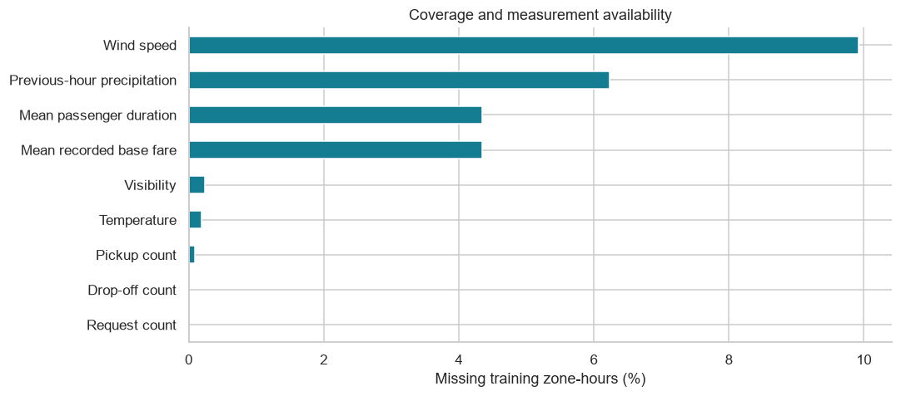

Figure 3.1: Share of training zone-hours missing each variable (nb02, cell 8). Request coverage is complete in training; the missing weather is limited to 9 real hours.

The figure shows that nothing in the training period lacks request coverage, and the only visible gaps are in weather. This is why the forecast and the simulator can use `request_count` without imputation in the training months.

# CHAPTER 4: LITERATURE REVIEW

## 4.1 Scope and honesty about sources

This review uses only the sources the team actually has: a related-research file prepared on 23 October 2026 (`ADS_related_research.pdf`), the data audit report, the course handout and its listed textbooks. The research file was built from a web search of abstracts and summaries, not a systematic literature review, and it says so itself. It marks how much of each paper was seen. We keep that mark in Table 4.1 ("read" means the abstract or page text was read; "summary" means only a search-result summary was seen). Numbers are quoted as the sources report them and have not been re-verified by us. Where the research file lacks a field, such as a year, we cite only what it has.

The file was assembled for an earlier framing of the project (journey times and buffers). It therefore holds good material on NYC for-hire demand, weather and drift, but little on fleet repositioning. Sections 4.3 and 4.4 say this plainly.

## 4.2 NYC taxi and ride-hailing demand and trip studies

Several studies use NYC taxi or for-hire records, which is the same kind of data as ours.

Brodeur and Nield study NYC taxi, Lyft and Uber rides in weather shocks. According to the summary we saw, Uber and Lyft rides per hour were roughly 22% and 19% higher when it rained, and taxi rides about 5% higher [@brodeur]. Oleyaei-Motlagh and Vela use 2013 yellow taxi records and find that demand rose in rain, which the authors attribute to more short trips [@oleyaei]. Kamga and colleagues, using taxi GPS data, report that rain led to more frequent but slightly shorter trips [@kamga].

Pandey, Guler and Gayah use TLC trip records aggregated by taxi zone and week and a difference-in-differences design to study the 2025 congestion toll; they report that total trips served by transportation network companies fell by about 5.95% [@pandey]. Li and Vignon study the 2019 ride-hailing surcharge with Uber, Lyft and yellow-cab volumes and report an overall fall of about 11% in ride-hailing volume [@livignon].

For prediction, Huang and colleagues use NYC taxi records with weather features and tree-based ensemble models, and find that separate short-term and long-term models help [@huang]. Jindal and colleagues propose a neural network for taxi trip time and distance, with about 17% lower mean absolute error than the methods they compared [@jindal]. Poongodi and colleagues compare an MLP and XGBoost on NYC taxi data; per the summary we saw, gradient boosting is a standard choice [@poongodi].

## 4.3 Fleet repositioning, cruising and idle time

The research file does not contain a study of fleet repositioning (rebalancing) or launch-area choice. The closest item is the TLC and Department of Transportation congestion study of for-hire vehicles. According to the summary we saw, it reports a 41% cruising rate in the Manhattan core, so that for an average 20-minute trip a driver spends almost 14 additional minutes cruising [@tlcdot]. This is the same cost our project prices: time spent driving or waiting without a passenger.

## 4.4 Autonomous-vehicle fleet placement

We did not find a source on autonomous-vehicle fleet placement in the team's research file. Waymo's own public trip reports were considered as data but not used, because location, time and mileage are redacted [@decisions]. This review therefore cannot claim to compare our results with published robotaxi placement results. [PENDING team to add: any peer-reviewed rebalancing or autonomous-fleet placement papers found by the team before submission, with author, title, year and venue exactly as published.]

## 4.5 Weather and demand

The studies in section 4.2 agree on the direction: rain raises ride counts and shifts the trip mix towards shorter trips [@brodeur; @oleyaei; @kamga]. Brodeur and Nield's numbers differ between versions of the paper, as the research file notes, and we treat the figures as indicative only. In our project weather is used only descriptively in the EDA, because we cannot show when a real weather feed would have been available at forecast time (section 5.7).

## 4.6 Congestion pricing and drift monitoring

January 2025 is our drift period, and the Manhattan congestion toll started on 5 January 2025. Cook and colleagues use Google Maps speed data and a synthetic-control design and report that the toll raised speeds in the cordon area by 11%, with spillovers outside it [@cook]. Ostrovsky and Yang argue that the toll hits personal-vehicle drivers much harder than passengers of taxis and ride-hailing vehicles [@ostrovsky]. Together with Pandey and Li and Vignon, these studies tell us that a change in January 2025 demand or trip lengths may come from the policy, not from model drift.

On drift itself, the research file lists a concept-drift survey [@conceptdrift], an urban time-series paper arguing for adapting to drift instead of only retraining on a schedule [@memda], and a paper showing forecast accuracy falling as conditions shift over time [@onlinelearning]. We know all three from summaries only; the survey's author and date were not confirmed, so we cite its title and arXiv number only.

## 4.7 Course textbooks and methods

The methods in this project come from the course handout: hypothesis testing, ensemble learning and gradient boosting, hyperparameter tuning, model calibration, optimisation, model monitoring and drift, and explainable AI using SHAP [@handout]. The listed textbooks that support these methods are Géron on scikit-learn and gradient boosting [@geron], Molnar on interpretable machine learning and SHAP [@molnar], Damji and colleagues on Apache Spark [@damji], Taddy, Hendrix and Harding on business analytics for decision making [@taddy], Huyen on designing machine learning systems [@huyen] and Lakshmanan and colleagues on machine learning design patterns [@lakshmanan].

## 4.8 Comparison of previous research findings

Table 4.1: Related studies, as reported in the team's research file

| Study | Data | Method | Main finding (as reported) | Reading status |
|---|---|---|---|---|
| Brodeur and Nield (2018) [@brodeur] | NYC taxi, Lyft and Uber rides | Regression of log ride counts on rain | Uber and Lyft rides about 22% and 19% higher in rain; taxi about 5% | Summary only |
| Oleyaei-Motlagh and Vela (2019) [@oleyaei] | 2013 NYC yellow taxi trips | Three demand and supply indices | Demand rose in rain, with more short trips | Abstract read |
| Kamga et al. [@kamga] | Taxi GPS data | Ridership analysis | More frequent but slightly shorter trips in rain | Summary only |
| Pandey, Guler and Gayah (2026) [@pandey] | TLC records by zone and week | Difference-in-differences | Total TNC trips fell about 5.95% after the toll | Abstract read |
| Li and Vignon (2024) [@livignon] | Uber, Lyft and yellow-cab volumes | Difference-in-differences | Overall ride-hailing volume fell about 11% after the 2019 surcharge | Abstract read |
| Cook et al. (2026) [@cook] | Google Maps speeds | Generalised synthetic control | Speeds in the cordon rose by 11% | Abstract read |
| Huang et al. (2020) [@huang] | NYC taxi trips, weather, routing data | Tree-based ensembles | Separate short- and long-term models help | Abstract read |
| Jindal et al. (2017) [@jindal] | NYC taxi trips | Neural network | About 17% lower MAE than compared methods | Abstract read |
| TLC and DOT (2019) [@tlcdot] | Manhattan for-hire vehicles | Policy modelling | 41% cruising rate in the Manhattan core | Summary only |

The studies differ in what they predict (counts, speeds, travel time), but they agree that NYC for-hire records are rich enough for zone-level analysis and that weather and policy changes shift demand.

## 4.9 Research gaps

1. **Forecasts are judged by error, not by profit.** The studies above evaluate counts, speeds or trip times. None of the sources we have evaluates a demand forecast by the profit of the fleet plan that uses it.
2. **Placement and launch-area choice are missing.** Our research file holds no study that links hourly demand to where idle cars should wait or which zones to serve first (section 4.3 and 4.4).
3. **Simple history is a strong baseline.** Our own work shows that a plain four-week mean is hard to beat (Chapter 7); studies that report model gains rarely say how they compare with such a baseline.
4. **Policy shifts complicate drift checks.** The January 2025 congestion toll means a drift period may contain a real policy change (section 4.6).

## 4.10 Contribution of the present project

The project contributes, within the limits of its data:

- a documented and independently verified zone-hour dataset from 259.9 million 2024 trips, with a corrected zone-neighbour graph and curated bridge links;
- a lag-based forecast evaluated honestly against simple history, with SHAP explanation;
- a fleet simulator and a launch-area search that score plans by profit, with one common price, explicit costs, paired tests and a service-gap check; and
- a drift check on January 2025 with the congestion-toll caveat.

We do not claim that nothing similar exists. Our search was limited to the files described in section 4.1, and the research file itself says it cannot rule out earlier work.

# CHAPTER 5: METHODOLOGY

## 5.1 Overall project workflow

Figure 5.1 shows the workflow. Each step reads tables produced by the step before it, and nothing is fitted, tuned or chosen on the test months.

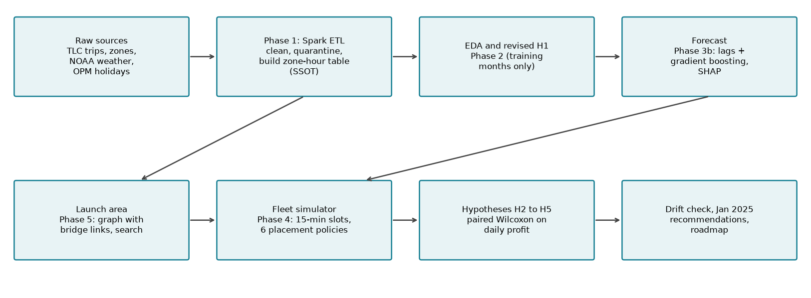

Figure 5.1: Overall project workflow from raw sources to recommendations. Phases follow the course project plan: Phase 1 ETL, Phase 2 EDA and H1, Phase 3b forecast, Phase 4 simulator, Phase 5 launch area, then hypothesis tests and the drift check.

## 5.2 Data collection and integration

Chapter 3 describes the five sources and the integrated tables. In short: Spark reads the 15 raw trip files, quarantines trips that fail quality rules, builds zone-hour counts keyed by real UTC hour, joins weather and calendar, and writes Parquet tables with a data dictionary and a SHA-256 manifest (handover [@handover]).

## 5.3 Data preprocessing and cleaning

**Accepted and quarantined.** A trip is **accepted** if it passes the essential-field and quality limits; otherwise it is **quarantined**. Quarantine is a flag or partition, not deletion, and accepted plus quarantined partition every input row exactly (decisions 2026-11-14 [@decisions]).

Table 5.1: Cleaning rules

| Rule | Limit |
|---|---|
| Duration (from `trip_time`) | 60 to 10,800 seconds inclusive (1 minute to 3 hours) |
| Speed (miles x 3,600 / seconds, positive seconds only) | 1 to 80 mph inclusive |
| Request time | Strictly before pickup (the largest single cause of exclusion) |
| Money | Missing, negative or non-finite amounts are flagged, never zero-filled; fare analysis needs a valid base fare, monetary analysis also valid tolls; tips never count as revenue |
| Zones | Missing or unrecognised IDs distinguished from recognised unmapped IDs 264 and 265; demand is kept for mapped pickups even when the destination is unmapped |

Table 5.2: Accepted and quarantined trips

| Scope | Input rows | Accepted | Quarantined | Quarantine share |
|---|---:|---:|---:|---:|
| 2024 only (12 months) | 239,470,448 | 237,061,250 | 2,409,198 | 1.01% |
| All inputs (2024, Jan 2025 and the two guard slices) | 259,885,329 | 257,269,699 | 2,615,630 | 1.01% |

(Source: brief section 5, recomputed from the per-month audit files; all-inputs row from run_summary `validated_cleaning_source_counts`.) The Phase 1 handover text says "259,885,329 cleaned rows"; that figure is the **input** count, and the cleaned (accepted) count is 257,269,699.

Table 5.3: Selected flag counts across the 14 analysis months (flags overlap)

| Flag | Rows |
|---|---:|
| Request not before pickup | 2,518,592 |
| Duration outside 60 to 10,800 s | 29,842 |
| Speed outside 1 to 80 mph | 80,463 |
| Non-positive trip seconds | 34 |
| Timestamp duration disagrees with `trip_time` (flagged, reported) | 134,678 |
| Negative base fare (flagged, not zero-filled) | 20,660 |
| Negative driver pay (flagged) | 2,181 |
| Repeated six-field key | 16 |
| Demand-eligible / simulation-eligible / fare-analysis-eligible | 257,250,514 / 246,591,452 / 257,240,101 |

A hypothetical 10-minute minimum trip length was checked on January 2024 only and **not adopted**: it would remove another 5,349,016 trips (27.4750% of the 19,468,657 accepted). The 1-minute minimum was kept (decisions 2026-11-15).

**Time handling.**

Table 5.4: Time handling rules

| Topic | Rule |
|---|---|
| Hourly key | Real UTC instants (`hour_start_utc`) |
| Calendar and splits | New York civil dates (`America/New_York`), not file names or fixed EST dates |
| Trip timestamps | Offset-free New York wall-clock time, interpreted as civil time |
| Weather clock | NOAA LCD v1 files are in local standard time, fixed UTC-5 all year. We verified this by comparing the CSV time with the UTC time inside the raw METAR report field for every routine report |
| Daylight saving | Events in the spring "missing" hour and the autumn repeated hour stay unresolved; we do not guess a fold or shift a timestamp. Eligible unresolved events: 59,615 request, 61,531 pickup, 54,468 drop-off |
| Impact | 526 zone-hours (2 real hours across 263 zones) have incomplete request coverage, all in the November to December test period |
| Holidays | OPM federal holidays by New York civil date; all holiday zone-hours verified |

(Source: decisions 2026-11-14, handover, run_summary.)

**Corrected zone neighbour table.** The released `zone_neighbours` table (692 directed edges, 346 pairs) was found incomplete during the team audit by Harsh Rohila. It used an exact "touches" test that returns false when two zone shapes overlap by a sliver (at most 0.1 m2) even though they share a long border; for example Co-Op City and Eastchester share about 5.6 km but were not linked. Recomputed from the same unchanged TLC shapefile with a 1 m tolerance and a 10 m minimum shared border, there are **651 neighbouring pairs (1,302 directed edges: 610 shared-border pairs and 41 corner-only pairs)**; all 346 old pairs are kept. Connected groups fell from 43 to 10, and zones with no neighbour from 32 to 6. Five new tests cover the logic (decisions 2026-11-15).

Even the corrected graph has 10 groups, because zones across a river or bay share no polygon border. We therefore added **35 curated bridge and tunnel links: 30 river crossings and 5 airport roads** (Table 5.5). With the river crossings the graph has 5 connected groups; with river and airport links it has 4 (source: `data/launch_area/connected_groups.csv`).

Table 5.5: Bridge and tunnel links added to the neighbour graph

| Link type | Links | Examples of crossings |
|---|---:|---|
| River crossing | 30 | Brooklyn, Manhattan and Williamsburg Bridges; Brooklyn-Battery and Queens-Midtown Tunnels; Queensboro and Triborough (RFK) Bridges; Verrazzano-Narrows Bridge; Cross Bay Veterans Bridge |
| Airport road | 5 | Van Wyck, Long Island Expressway and Midtown Tunnel; Grand Central Parkway to Triborough Bridge; Holland and Lincoln Tunnels; Goethals Bridge |

The corrected table is rebuilt locally from `src/phase1_sources.py` and the links are stored in `data/launch_area/bridge_links.csv`. It is not yet in a published release [PENDING P-24: corrected release or documented rebuild step]. `shared_boundary_metres` is approximate (up to about 2 m too long per border) and is used only to rank borders.

## 5.4 Exploratory data analysis (EDA)

All EDA uses the **training period only** (January to August 2024; 1,539,865 zone-hours, 5,855 real hours, 263 zones) (nb02, cell 6). We look at data coverage and provider differences, demand over time and by zone, weather and holiday associations, pickup and drop-off imbalance, and simple historical forecasts. Results are in section 7.1.

## 5.5 Feature engineering and selection

The forecast target is `request_count` for a zone and hour. Every input must be known at least seven days before the forecast hour, so that the forecast could be made in advance in practice (the "known-ahead" rule).

Table 5.6: Forecast inputs

| Input group | Fields |
|---|---|
| Demand history of the same zone | Demand 7, 14, 21 and 28 days earlier at the same hour (`lag_7d`, `lag_14d`, `lag_21d`, `lag_28d`), their four-week mean (`lag_mean_4w`) and the ratio of last week to that mean (`lag_7d_ratio`, computed as (last week + 1) / (mean + 1)); a flag for whether each lagged day was a federal holiday |
| Calendar | New York civil weekday, hour, month, weekend flag, federal holiday flag, and sine and cosine terms of hour and weekday |
| Location | Zone centroid latitude and longitude, airport flag, borough |

(Source: src/demand_features.py and the feature list in forecast_summary.json.) Weather is not an input, because we cannot show when a real feed would have published it. No feature selection step was used beyond the known-ahead rule; SHAP (section 7.4) shows which inputs matter.

## 5.6 Statistical analysis and hypothesis testing

**Revised H1 (demand differs across zones and hours).** The method was fixed before looking at results (nb02, cells 23 and 24). We use only complete Monday-to-Sunday weeks with 168 real, covered hours in all 263 zones: **33 weeks** (the first week starts on 1 January, the last on 19 August 2024; the spring daylight-saving week and partial boundary weeks are excluded). Each week gives one mean per zone and one mean per clock hour. Friedman's test compares categories within each week (weeks are the blocks). Two tests are run, so a Bonferroni correction of 2 applies. We report Kendall's W (rank agreement from 0 to 1) and **share mismatch** (half the absolute gap between each category's demand share and an equal share). Uncertainty comes from a seeded two-week moving-block bootstrap (2,000 repeats). An illustrative 10% share-mismatch threshold defines "meaningful"; 5% and 20% are shown as sensitivity.

**H2 to H5 (profit comparisons).** Plans run on the **same test days** (57 main days of November and December 2024) with the same fleet sizes (25, 50 and 100 cars), allowed zones and operating rules, and with the same simulated requests, since there is one random seed per day. Daily profit per car is compared in pairs with the **Wilcoxon signed-rank test** (paired, non-parametric, one-sided for "the first plan earns more"). We also report the median paired daily difference, its size relative to the second plan's median profit, and a seeded bootstrap interval for the median (5,000 resamples). Four hypotheses are tested at each fleet size, so p-values are **Holm-adjusted** across H2 to H5 at that fleet size. The verdict rule was written before any test day was simulated (section 7.2.3): a fleet size passes when the adjusted p-value is below 0.05, the median difference is positive and the gain is at least 1%; a hypothesis is supported if at least two of three fleet sizes pass. Holiday days in the test months (11 November Veterans Day, 28 November Thanksgiving, 25 December Christmas, per the OPM list [@opm]) and the 3 November clock-change day (25 hours) are reported separately as description, because three days and one day are too few for a test (section 7.2.5). A minimum service level is reported but not enforced. Results are associations that hold under the stated assumptions, not causal claims [@guidelines].

Table 5.7: Baselines (every plan uses the same fleet sizes, allowed zones and operating rules)

| Baseline | What it does |
|---|---|
| Copy last week | Places cars as demand was in the same hour last week |
| Four-week mean | Places cars by the mean of the four previous matching weekday-hours |
| Ride-count plan | Places cars by number of rides, ignoring value |
| Fixed Manhattan plus Downtown Brooklyn area | Fixed launch area for the H2 comparison |
| Cars staying put | No repositioning, for the H5 comparison |
| Random and equal allocation | Extra comparisons added in the Phase 2 revision |

## 5.7 Analytical and model development: the demand forecast

**Question.** Can a model predict requests per zone-hour better than simple history, using only information at least seven days old?

**Model.** We use gradient boosting for regression (scikit-learn `HistGradientBoostingRegressor`) [@geron]. Four candidate settings were tried (squared-error and Poisson loss, each in a small and a large version) and tuned on September 2024. The chosen candidate is squared-error loss with learning rate 0.1, 200 iterations, at most 15 leaf nodes and at least 200 samples per leaf (forecast_summary.json). The model is fitted on the training months (1,539,865 rows) with a fixed random seed (20261115).

**Calibration.** A global count-bias scale of 1.0213 was fitted on 1 to 15 October 2024.

**Choice between methods.** The model (raw and scaled) and the simple methods were then compared on 16 to 31 October 2024, and the best of them was frozen before November and December were scored. The "frozen choice" is the plain four-week mean (section 7.3).

**Explanation.** SHAP (TreeExplainer) gives each input's average effect on the forecast [@molnar] (section 7.4).

## 5.8 Simulator and launch-area optimiser

**Simulator.** The simulator turns a placement plan into profit on the test days. It replays one New York civil day at a time on a 15-minute grid (src/fleet_sim.py).

Table 5.8: Simulator design

| Element | Design |
|---|---|
| Time structure | Hourly placement; 15-minute matching. Each hour's demand is split evenly into four 15-minute slots by a seeded draw, because the release has only hourly counts |
| Demand | Observed test-period request counts by zone and hour, thinned to a **demand scale of 0.01** (1%) by a seeded draw so that the fleet is hundreds of cars, not tens of thousands |
| Trip length | Each request draws a destination from the training origin-destination table of its origin zone; miles and minutes are the training medians. Pairs without enough training trips use straight-line distance times a **detour factor of 1.40** at an average speed of **14.6 mph** |
| Matching | A free car in the same zone first; otherwise the nearest free car within a few neighbour steps; otherwise the request is lost. Neighbour steps use polygon borders only: the 35 bridge links are not used for matching or repositioning |
| Revenue | A **common price** in every zone: **9.76 dollars base plus 3.51 dollars per passenger mile** (R-squared 0.957 against recorded fares; mean recorded fare 25.52 dollars). No time charge, no tips |
| Costs | **1.36 dollars per mile on all miles** (empty miles included), **2 dollars per idle car-hour**, and tolls set to the origin zone's training mean toll |
| Policies | Stay; ride-count; profit-based; equal; random; wait-or-move (a freed car drives empty to its best neighbour if the neighbour's forecast is high enough) |
| Service area | A request counts only if it starts inside the launch area. If its trip ends outside the area it is dropped (a geofence), so the share served cannot exceed about 73% in the fixed area (27% of requests starting there end outside) |
| Missing demand | Zone-hours with missing request counts (hour 1 of 3 November) are simulated as zero demand |
| Service level | The per-zone served share is reported; the minimum service level is reported, not enforced inside the simulator |
| Randomness | Every random choice uses a fixed seed: simulation seed 20261115 (one seed per day, the same requests for every plan); bootstrap seed 20261116 |
| Fleet sizes | 25, 50 and 100 cars at 1% demand, chosen by a utilisation rule on October validation days (section 7.2.2) |

(Source: src/fleet_sim.py documentation, data/results/frozen_settings.json and docs/decisions.md.) One simulation seed is used per day, so each plan is run once on each day; the report does not show variation from repeating a day with other seeds. Policies are decided from the forecast only; the simulator never shows a policy the actual demand.

**Common price.** Krish proposed using the same price in all areas. It keeps the question "where should cars wait?" separate from "which area has historically higher fares". The two rates are fitted to recorded fares on training data. Recorded fares remain background and are used for calibration only.

**Launch-area optimiser.** The optimiser chooses a **connected** set of zones (connected through the corrected neighbour table plus the 35 bridge links) with a greedy "grow from a seed zone" step followed by a local search (add, remove or swap one zone at a time) (src/launch_area.py). It scores an area with a cheap, explainable proxy (expected profit per car-hour) computed from **training data only**, so the search can run without the full simulator. The proxy uses nominal planning rates (2.50 dollars plus 1.60 dollars per mile) and a nominal fleet of 1,000 cars, not the fitted price. Its constants are nominal and it is only a search aid; the simulator is the real score. The final objective is the proxy profit per car-hour over a connected set of at most the stated number of zones. The fixed baseline area has 71 zones: all Manhattan zones (66) plus Downtown Brooklyn (5), which hold 41.4% of training demand (the ferry-only zones 103, 104 and 105 are excluded).

## 5.9 Validation and evaluation approach

**Time split.** Nothing is fitted, tuned or chosen on the test months [@preSubmission; @decisions].

Table 5.9: Time split

| Period | Dates (New York civil dates) | Real hours | Zone-hours (263 zones) | Use |
|---|---|---:|---:|---|
| Train | 1 Jan to 31 Aug 2024 | 5,855 | 1,539,865 | Fit models and references |
| Validation | 1 Sep to 31 Oct 2024 | 1,464 | 385,032 | Choose settings and methods |
| Test | 1 Nov to 31 Dec 2024 | 1,465 | 385,295 | Final comparison of plans (61 calendar days) |
| Drift check | January 2025 | 744 | 195,672 | Drift only, never for tuning |
| Boundary guards | December 2023, February 2025 | n/a | n/a | Only repair file-boundary effects; never extend the analysis period |

(Source: nb02, nb03, handover. The test period includes the 25-hour day of 3 November.)

**Metrics.** Forecasts are scored by mean absolute error (MAE, in requests per zone-hour), root mean squared error (RMSE) and weighted absolute percentage error (WAPE, total absolute error divided by total actual demand). Plans are scored by the KPIs in Table 2.2.

**Previously examined test months (important honesty point).** In an earlier version of the forecast experiment (rolling lags of recent counts), the November-December scores were read. That version was withdrawn because it assumed recent counts are known instantly, which cannot be shown. The final forecast was chosen on September and October only, and its selection file was saved before November and December labels were read (frozen_choice.json), but **the labels were already seen once, so November-December is not a pristine, unseen test** [@decisions]. The January 2025 drift period must not be repurposed as a new test. We therefore freeze every setting before the simulation, report the forecast scores as diagnostic, and do not claim fresh confirmatory evidence for the forecast. Every simulation setting was chosen on 30 October validation days only and saved in `frozen_settings.json` before any test day was simulated (section 7.2.2), and the verdict rule was written before the test run. Two analyses were added after the first look at the test results (staying put against profit placement, and the H2b follow-up) and are labelled post hoc.

## 5.10 Model comparison and optimisation techniques

The forecast is compared with four simple methods (Table 5.10). Each uses the same rows, so the comparison is fair.

Table 5.10: Forecast methods compared

| Method | Description |
|---|---|
| Model, scaled | Gradient boosting multiplied by the count-bias scale 1.0213 |
| Model, raw | Gradient boosting without the scale |
| Mean of previous 4 weeks | Mean of the same zone-hour in the previous four matching weekdays (`lag_mean_4w`) |
| Last week | Demand 7 days earlier (`lag_7d`) |
| Frozen 28-day and 7-day profiles | Profiles built once from the last 28 or 7 training days and looked up by zone, weekday and hour (Krish's earlier baselines) |

Improvement techniques used: hyperparameter selection on September, a one-parameter calibration on early October, method selection on late October, and a local search for the launch area. The model is not made more complex to beat a baseline: the frozen choice rule decides.

## 5.11 Methodological assumptions and limitations

**Revenue and cost rules.**

Table 5.11: Revenue and cost rules

| Item | Rule as finally used |
|---|---|
| Revenue | Common price in every zone: 9.76 dollars base plus 3.51 dollars per passenger mile; no passenger time charge; no tips |
| Cost per mile | 1.36 dollars per mile on **all** miles, empty miles included |
| Idle cost | 2 dollars per idle car-hour |
| Tolls | Charged as a cost, using the origin zone's training mean toll |
| Trip duration | Still counted: it decides how long a car is busy and when it is free again |
| Sensitivity | 0.74 and 2.00 dollars per mile; 0 and 5 dollars per idle hour |

The 1.36 dollars per mile figure is a team assumption from the pre-submission plan [@preSubmission]. We did not find a published basis for this figure in our source files, so it is treated as an assumption and varied in the sensitivity runs (section 7.2.6), together with the nominal price of 2.50 dollars plus 1.60 dollars per mile.

**Assumptions.** Demand is the observed completed-trip requests (a proxy for robotaxi demand); riders do not react to price or wait; hourly counts are split evenly into 15-minute slots; travel times come from human drivers; weather is not a forecast input. Chapter 7 lists limitations (section 7.12).

# CHAPTER 6: TECHNOLOGY STACK

## 6.1 Programming languages

**Python** is the main language. Three environments were used: Python 3.11 for the Phase 1 Spark ETL and its tests (Spark 4.0.1 needs Java 17 or 21), Python 3.12 for the EDA and first forecast notebooks, and Python 3.14 for the final analysis environment used for the Phase 3b forecast, the simulator, the launch-area search and this report. SQL (through DuckDB) was used to read the Parquet tables where `pyarrow` was blocked by a Windows policy in the analysis environment.

## 6.2 Software and development environments

- **Apache Spark 4.0.1 with PySpark** for the ETL over 259.9 million trip records (Java 17 or 21) [@damji].
- **Jupyter** notebooks, run non-interactively with **nbclient** and **ipykernel**, hold the EDA and forecast work.
- **Git and GitHub** for version control; a public repository is required by the course [@handout].
- **Docker** was used to run the Phase 1 tests on Linux; the Phase 1 test suite does not run on Windows because `tests/conftest.py` calls `time.tzset()`.
- **pytest** for unit tests and **ruff** as the automatic code checker, run before every pull request.

## 6.3 Libraries and frameworks

Table 6.1: Main libraries and their roles

| Library | Version (where recorded) | Role |
|---|---|---|
| pandas | 3.1.1 | Tables in notebooks and simulator |
| NumPy | 2.5.4 | Arrays and seeded random draws |
| SciPy | 1.18.1 | Friedman, Wilcoxon and other tests |
| statsmodels | 0.15.0 | Statistical modelling in the EDA environment |
| scikit-learn | 1.9.1 | `HistGradientBoostingRegressor` forecast [@geron] |
| SHAP | 0.54.1 | Explanation of the forecast [@molnar] |
| Shapely, PyShp, pyproj | 2.1.2, 2.3.1, 3.7.2 (Phase 1) | Zone geometry, neighbours and map projection |
| joblib | 1.6.0 | Saving the frozen model |
| PySpark | 4.0.1 | Distributed ETL |
| FastAPI, uvicorn | 0.163.1, 0.54.0 | Small forecast service in `service/` (built and tested; Docker image built and run) |
| MLflow | 3.18.0 | Local experiment log (`notebooks/07_mlflow_tracking.py`; runs stored in the git-ignored `mlruns/` folder) |

## 6.4 Database and data storage tools

All prepared tables are stored as **Parquet** files with a JSON data dictionary and a SHA-256 manifest. **DuckDB** 2.0.0 queries the Parquet files directly in the analysis environment, because `pyarrow` was blocked by a Windows policy there. PyArrow 24.0.0 is used in the Phase 1 and EDA environments. Raw and processed data are never committed to Git; they are rebuilt or downloaded.

## 6.5 Analytical and visualisation tools

**matplotlib** 3.11.2 and **seaborn** 0.13.2 draw the figures; bar charts of SHAP values show the forecast inputs; map figures use Shapely geometry and the TLC zone shapefile.

## 6.6 Frontend or user interface technologies

The project has no user interface beyond notebooks and figures. A small **FastAPI** forecast service is the only interface (section 7.9): `GET /health` and `POST /forecast`. It runs with `uvicorn --factory service.forecast_api:create_app_from_environment --port 8000` or from a Docker image built with the steps in `service/README.md`.

## 6.7 Hardware and computational resources

Team laptops were used for all work. [PENDING hardware - team to confirm: processor, memory and operating system of the machine that ran the Phase 1 ETL, and of the machine that ran the simulator.] The analysis environment ran on Windows 11. The simulator runs on a single machine; the ETL is run as a local Spark job, not on a cluster.

# CHAPTER 7: EXPERIMENTAL RESULTS AND DISCUSSION

This chapter reports what the data and the experiments show. Every figure and table is numbered, titled and explained. **All simulation and November-December numbers are for a previously examined period, not a pristine test**, and each result table carries a note to that effect. Findings are associations in a simulation on a proxy of robotaxi demand. The H2b follow-up (section 7.2.7) and the stay-put comparison (section 7.2.4) are post hoc and exploratory, and are labelled as such.

## 7.1 Data analysis and visualisation results

All EDA uses the training period only (January to August 2024). A "request" is an eligible completed-trip request, not total market demand and not unserved requests.

### 7.1.1 Coverage and provider differences

No training zone-hour has incomplete request coverage; 66,983 covered zone-hours (4.35%) have genuinely zero requests (nb02, cell 8, and Figure 3.1). 2,367 training zone-hours (9 hours x 263 zones) have no primary weather. Provider exclusions differ between Uber and Lyft (Table 7.1).

Table 7.1: Provider chronology exclusions, January to August 2024 (request not before pickup)

| Provider | Input trips (request-hour view) | Exclusions | Rate |
|---|---:|---:|---:|
| Uber (HV0003) | 118,302,654 | 775,465 | 0.655% |
| Lyft (HV0005) | 40,875,975 | 692,145 | 1.693% |

(Source: nb02, cell 10.) Lyft trips are excluded at a higher rate than Uber trips. The cause and direction of any bias in the demand proxy are not established.

### 7.1.2 Demand over time and by zone

Figure 7.1 shows daily demand and demand per covered zone-hour. Demand is flat from January to August with a mild summer dip (Table 7.2).

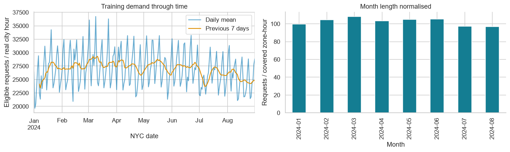

Figure 7.1: Daily mean city demand (left) and month-length-normalised demand per covered zone-hour (right) (nb02, cell 12).

Table 7.2: Demand by month, January to August 2024

| Month (2024) | Zone-hours | Observed eligible requests | Requests per zone-hour |
|---|---:|---:|---:|
| Jan | 195,672 | 19,468,463 | 99.5 |
| Feb | 183,048 | 19,153,443 | 104.6 |
| Mar | 195,409 | 21,093,564 | 107.9 |
| Apr | 189,360 | 19,551,868 | 103.3 |
| May | 195,672 | 20,511,578 | 104.8 |
| Jun | 189,360 | 19,929,767 | 105.2 |
| Jul | 195,672 | 18,990,552 | 97.1 |
| Aug | 195,672 | 18,942,758 | 96.8 |

(Source: nb02, cell 8; the last column is requests divided by zone-hours.) March has 195,409 zone-hours, not 195,672, because spring daylight saving removes one real hour on 10 March.

Figure 7.2 shows the weekly rhythm. The busiest weekday-hour cell in the training period is **Saturday at 22:00, averaging 47,676 eligible city requests** (nb02, cell 12).

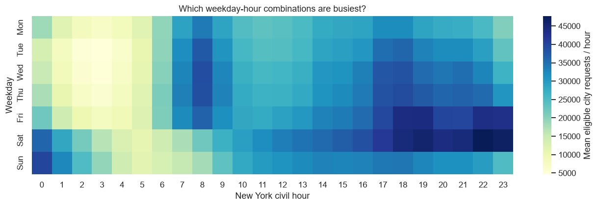

Figure 7.2: Mean eligible city requests per hour by weekday and New York clock hour (nb02, cell 12).

Figure 7.3 shows how concentrated demand is across zones.

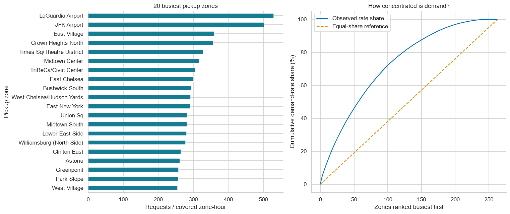

Figure 7.3: The 20 busiest pickup zones (left) and how concentrated demand is (right) (nb02, cell 14).

The two airports (LaGuardia and JFK) are the busiest pickup zones, each at roughly 500 or more requests per covered zone-hour (read from Figure 7.3), followed by East Village, Crown Heights North, Times Sq/Theatre District and Midtown Center. **The top 10 of 263 zones account for 13.33% of summed mean demand rates** (nb02, cell 14). Zone rank is very stable: the Spearman correlation of zone demand ranks between January-April and May-August is 0.998 (nb02, cell 18).

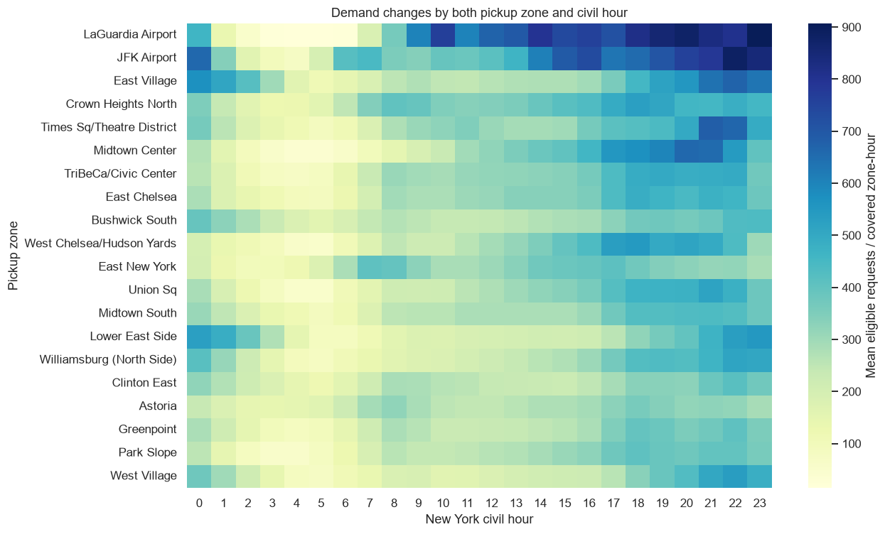

Figure 7.4: Demand by pickup zone and hour for the 20 busiest zones (nb02, cell 14).

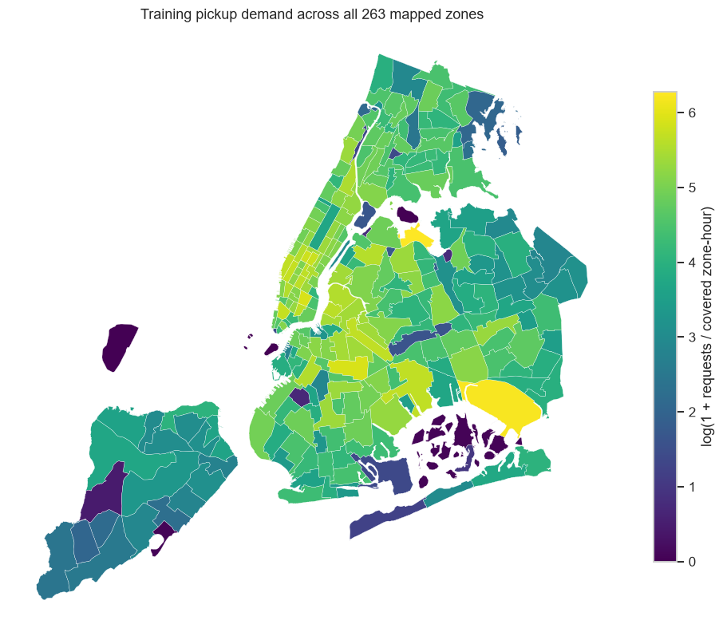

Figure 7.5: Mean pickup demand across all 263 mapped zones, log colour scale (nb02, cell 14). Zones differ greatly in size, so colour is not demand per resident or per square kilometre.

### 7.1.3 Weather and holidays (descriptive associations)

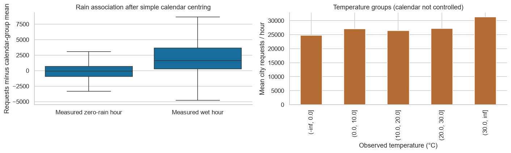

Figure 7.6: Requests after simple calendar centring in measured wet and zero-rain hours (left); mean city requests by temperature group, calendar not controlled (right) (nb02, cell 20).

After subtracting each month-weekday-hour mean, the 490 measured wet hours average **+2,087 requests per hour** relative to that reference, against **-205** for the 5,000 measured zero-rain hours (medians +1,622 and -93) (nb02, cell 20). Hours with missing or trace-only precipitation are not labelled dry. This is an association, not a causal estimate. The direction agrees with the published studies in section 4.5.

Table 7.3: Training holidays versus matched non-holiday days (requests per real city hour)

| Holiday | Holiday day | Matched non-holiday mean | Comparison days |
|---|---:|---:|---:|
| New Year's Day, 1 Jan | 26,476 | 22,476 | 3 |
| Martin Luther King Jr. Day, 15 Jan | 23,060 | 22,476 | 3 |
| Washington's Birthday, 19 Feb | 22,775 | 23,594 | 3 |
| Memorial Day, 27 May | 21,326 | 23,822 | 3 |
| Juneteenth, 19 Jun | 24,755 | 26,493 | 3 |
| Independence Day, 4 Jul | 23,183 | 26,247 | 3 |

(Source: nb02, cell 20.) With only three comparison days each, these are shown as description, not as strong evidence. New Year's Day and Martin Luther King Jr. Day are above their comparison days; the other four holidays are below.

### 7.1.4 Imbalance and quieter zones

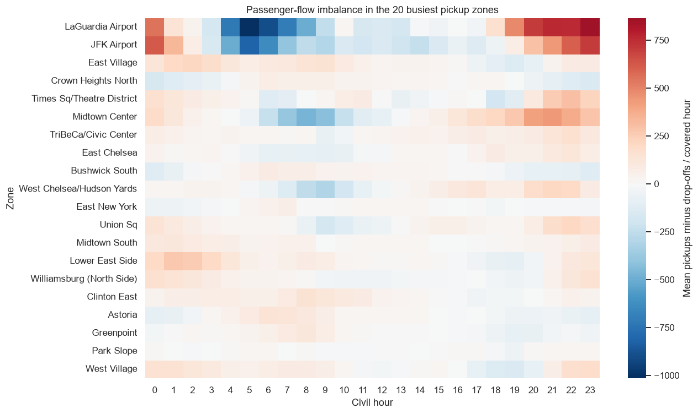

Figure 7.7: Mean pickups minus drop-offs per covered hour in the 20 busiest zones (nb02, cell 22). A positive value means more departures than arrivals. It is not a measured empty-car shortage, because the data hold no vehicle IDs or unserved requests.

Table 7.4: Zones split into four equal-count demand groups by training mean request rate

| Demand group | Zones | Mean requests per hour | Mean four-week-forecast MAE |
|---|---:|---:|---:|
| Low | 66 | 14.4 | 3.9 |
| Lower-middle | 66 | 56.9 | 8.5 |
| Upper-middle | 65 | 111.0 | 14.1 |
| High | 66 | 227.3 | 29.8 |

(Source: nb02, cell 22.) The error grows with demand level in absolute terms, as expected.

### 7.1.5 Historical benchmarks

On 2,208 common development hours (580,704 zone-hour comparisons, June to August), the rolling "same hour last week" forecast has MAE 17.26 requests per zone-hour and the rolling four-matching-week mean has MAE **14.07** (WAPE 17.32% and 14.12%); an equal-share reference has MAE 71.15 (nb02, cell 18). The median within-zone correlation with last week's demand is 0.858. These are the early rolling baselines; section 7.3 reports the final forecast comparison.

## 7.2 Statistical analysis and hypothesis assessment

### 7.2.1 Revised H1: demand differs across zones and hours

The method is in section 5.6. Table 7.5 gives the results.

Table 7.5: Revised H1 tests on 33 complete training weeks

| Comparison | Weeks | Categories | Friedman chi-square | Adjusted p | Kendall's W | Share mismatch | 95% interval |
|---|---:|---:|---:|---|---:|---:|---|
| Pickup zone | 33 | 263 | 8,612.66 | below numerical precision (displays as 0) | 0.9961 | 34.07% | 33.90% to 34.28% |
| Hour of day | 33 | 24 | 740.41 | 2.68e-141 | 0.9755 | 13.64% | 13.42% to 13.91% |

(Source: nb02, cell 24.) Intervals with one-week and four-week blocks are nearly identical. The lower bounds exceed 5% and 10% in both comparisons but not 20%.

**Result: supported within this exploratory design.** Both adjusted p-values are below 0.05 and both lower bounds exceed the 10% convention.

**Honest caveat.** The 10% threshold is a convention we chose, not a statistical law, a guaranteed profit gain or a causal effect. With Kendall's W near 1, the test mostly confirms what the maps already show: **zones differ in size, and a big zone stays big every week**. Weeks remain dependent over time, and completed-trip sampling, provider exclusions and zone size all contribute. The result shows that equal placement would not match demand; it does not show that a smarter placement earns more profit. That question belongs to H2 to H5.

### 7.2.2 H2 to H5: how the simulation test was set up

H2 to H5 are tested in the fleet simulator (section 5.8). Every plan is run on the same days, with the same simulated requests, so the only difference between two plans is where the cars wait and move. The test days are the 57 ordinary days of 1 November to 31 December 2024. Three federal holidays (11 November, 28 November, 25 December) and the 3 November clock-change day (25 hours, and the day with missing hour-1 request counts) are left out of the main test and reported separately in section 7.2.5, which makes 61 days in all.

**Important:** November and December 2024 had already been looked at by the team before the simulation was built (section 5.9). To limit the damage, every simulator setting was chosen on 30 October 2024 validation days only (October 14, a federal holiday, was left out) and saved in a file, `frozen_settings.json`, before any test day was simulated. The file records this itself. All numbers in this section are therefore labelled "previously examined period, not a pristine test": they describe what happened in that period, and are not fresh confirmation.

Table 7.6: Simulator settings frozen on October validation days, before any test day was simulated

| Setting | Value used | How it was chosen |
|---|---|---|
| Fleet sizes | 25, 50 and 100 cars at a demand scale of 1% | The first suggested sizes (100, 250, 500 cars) left most cars idle on the October days (utilisation 27%, 9.6% and 4.4%). The rule written beforehand was: keep a set only if every utilisation is between 15% and 95%, otherwise fall back to 25, 50 and 100 cars (utilisation 54%, 44% and 27%). Table 7.7 |
| Placement parameter "requests per car-hour" | 1 (25 cars), 4 (50 cars), 3 (100 cars) | Highest mean profit per car on the October days for the profit plan, among 1, 2, 3 and 4. It is the number of requests one car is assumed to serve per hour when deciding how many cars a zone needs. The profit hardly changes between these values |
| Wait-or-move threshold (`move_ratio`) | 0.1 for every fleet size | Best of 0.1, 0.25, 0.5, 0.75 and 1.0. A car moves only if its own zone's forecast is below this share of the best neighbour's forecast, so 0.1 means "move rarely". It is the edge of the grid: the smaller the value the better, so an even smaller value was not tried |
| Data-chosen launch area (for H2) | The 60-zone area for 25 cars; the 71-zone area for 50 and 100 cars | Highest mean October profit per car among the proxy-optimal candidates (Table 7.8). The fixed baseline area beat every candidate on the October days by a wide margin |
| Price | 9.76 dollars plus 3.51 dollars per mile in every zone (main); 2.50 plus 1.60 per mile (nominal, as a sensitivity run) | The main rates are a least-squares fit to recorded fares (R-squared 0.957). They are a calibration, not a pricing proposal |
| Costs | 1.36 dollars per mile on all miles, 2 dollars per idle car-hour, origin-zone mean toll | Team assumptions (section 5.11); varied in section 7.2.6 |
| Test days | 57 main days, plus 3 holidays and the 3 November clock-change day reported separately | Fixed in advance |
| Random seeds | Simulation seed 20261115 (one seed per day, so every plan sees the same requests); bootstrap seed 20261116 with 5,000 resamples | Fixed |
| Forecast given to the plans | "Model forecast": the gradient-boosting forecast of section 7.3 (with its count-bias scale). Copy last week, the four-week mean and the frozen 28-day profile are run as comparisons | Where last-week or four-week forecasts were missing (hour 1 on four Sundays, 10, 17 and 24 November and 1 December, because of the missing 3 November counts) the frozen profile was used instead |

(Source: data/results/frozen_settings.json and validation_tuning.csv.) *Chosen on October validation days; applied to a previously examined period, not a pristine test.*

The simulator's headline "forecast plan" uses the gradient-boosting forecast, not the four-week mean that the forecast study froze (section 7.3). The two are close, and the four-week-mean plan is run as a comparison (Table 7.13, row X1).

Table 7.7: Fleet-size check on the 30 October 2024 validation days (profit plan, default settings, fixed baseline area)

| Cars (1% demand scale) | Mean profit per car per day (USD) | Mean utilisation | Mean served share |
|---:|---:|---:|---:|
| 100 | 196.8 | 27.2% | 67.7% |
| 250 | 61.6 | 9.6% | 72.4% |
| 500 | 8.0 | 4.4% | 72.8% |
| 25 | 373.1 | 53.8% | 30.3% |
| 50 | 310.6 | 43.9% | 51.1% |

(Source: data/results/validation_tuning.csv.) With 250 or 500 cars at 1% demand there are far more cars than requests, so utilisation falls to 9.6% and 4.4% and profit per car collapses. Those sizes would measure idle cars, not placement, so the pre-agreed rule replaced them. *Validation days only.*

Table 7.8: Choosing the data-chosen launch area on the 30 October 2024 validation days (mean profit per car per day, USD, profit plan)

| Launch area (profit plan, 30 October days) | 25 cars | 50 cars | 100 cars |
|---|---:|---:|---:|
| Fixed baseline (71 zones) | 376.5 | 311.1 | 196.9 |
| Proxy-optimal 15 zones | 62.2 | 13.5 | -15.8 |
| Proxy-optimal 30 zones | 148.4 | 74.9 | 19.5 |
| Proxy-optimal 60 zones | 266.9 | 184.6 | 96.9 |
| Proxy-optimal 71 zones | 260.2 | 185.9 | 102.1 |
| **Chosen as the data-chosen area** | 60 zones | 71 zones | 71 zones |

(Source: data/results/validation_tuning.csv.) The best data-chosen candidates earned far less per car than the fixed Manhattan plus Downtown Brooklyn area on the October days, at every fleet size. This already pointed towards a negative H2 before any test day was simulated; the rule still required the test.

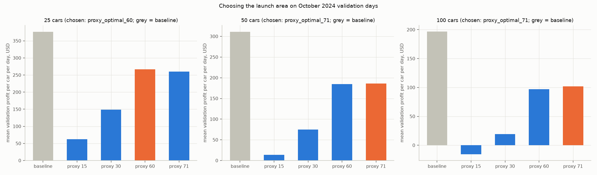

Figure 7.8: Mean October validation profit per car per day for the fixed baseline (grey) and the four proxy-optimal areas. The orange bar is the area chosen for that fleet size. In every panel the grey bar is the tallest (data/results/fig_h_validation_area_choice.png).

Figure 7.8 shows the area choice on the validation days. The areas picked by the rough proxy score earn well below the fixed area, and the 15-zone and 30-zone areas earn very little or lose money at 100 cars. This is the reason for the post hoc follow-up H2b in section 7.2.7.

### 7.2.3 H2 to H5: verdicts

**Verdict rule (written before the test days were simulated).** For each fleet size, the first plan "passes" if the Holm-adjusted one-sided Wilcoxon p-value is below 0.05 (Holm correction over the four hypotheses H2 to H5 at that fleet size), the median paired daily difference is positive, and the gain is at least 1% of the second plan's median daily profit per car. It is on the "wrong side" if the median difference is zero or negative, or if the p-value is 0.05 or more and most of the bootstrap interval is below zero. A hypothesis is **supported** if at least two of three fleet sizes pass, **not supported** if at least two are on the wrong side, and **inconclusive** otherwise. (Source: src/hypothesis_tests.py.) The comparisons are made in the fixed Manhattan plus Downtown Brooklyn area for H3 to H5, which was decided in advance; the same tests in the data-chosen area are a robustness check.

Table 7.9: Hypothesis verdicts H2 to H5 (57 main test days; fixed baseline area for H3 to H5)

| Hypothesis (first plan minus second plan) | Median daily difference, USD per car (25 / 50 / 100 cars) | Relative gain (25 / 50 / 100 cars) | Verdict |
|---|---|---|---|
| H2 data-chosen area vs fixed area | -96.7 / -119.9 / -93.1 | -25.8% / -38.7% / -46.8% | **not supported** |
| H3 profit vs ride-count placement | +20.8 / -0.9 / -4.6 | +5.8% / -0.3% / -2.2% | **not supported** |
| H4 forecast model vs copy last week | +0.4 / +0.8 / 0.0 | +0.1% / +0.3% / 0.0% | **inconclusive** |
| H5 wait-or-move vs stay | +0.2 / -0.6 / 0.0 | 0.0% / -0.2% / 0.0% | **not supported** |

(Source: data/results/hypothesis_summary.csv.) *Previously examined period, not a pristine test. Differences are the first plan minus the second plan, in US dollars of profit per car per day.*

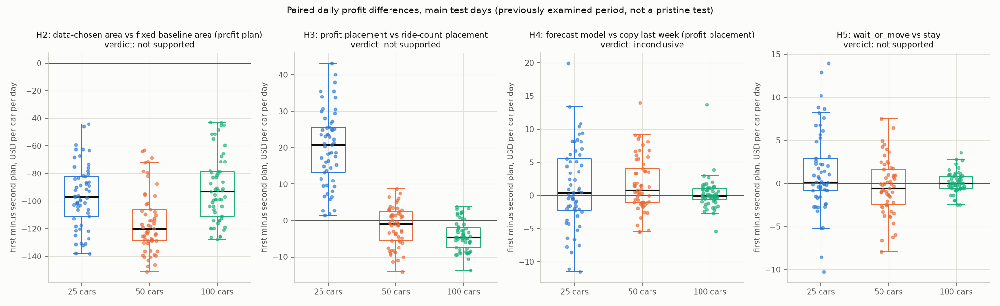

Figure 7.9: Paired daily profit differences for H2 to H5 (one dot per test day, first plan minus second plan, in dollars per car per day; the black bar is the median) (data/results/fig_h_paired_differences.png). *Previously examined period.*

Figure 7.9 shows every test day as a dot. H2 is far below zero for all three fleet sizes. H3 is well above zero at 25 cars but at or below zero at 50 and 100 cars. For H4 and H5 the dots are scattered around zero: the plans differ by only a few dollars a day, in both directions.

Table 7.10: Detail for H2 to H5 (57 main test days; fixed baseline area for H3 to H5)

| Hypothesis | Cars | Median daily difference (USD per car) | Relative gain | 95% interval of the median | Days first plan wins | Holm p (one-sided) | Fleet-size result |
|---|---:|---:|---:|---:|---:|---:|---|
| H2 data-chosen area vs fixed area | 25 | -96.7 | -25.8% | -101.6 to -88.8 | 0% | 1.000 | wrong side |
|  | 50 | -119.9 | -38.7% | -125.3 to -113.9 | 0% | 1.000 | wrong side |
|  | 100 | -93.1 | -46.8% | -99.1 to -86.2 | 0% | 1.000 | wrong side |
| H3 profit vs ride-count placement | 25 | +20.8 | +5.8% | 17.2 to 23.6 | 100% | below 0.001 | passes |
|  | 50 | -0.9 | -0.3% | -3.2 to 1.2 | 42% | 1.000 | wrong side |
|  | 100 | -4.6 | -2.2% | -5.5 to -3.3 | 19% | 1.000 | wrong side |
| H4 forecast model vs copy last week | 25 | +0.4 | +0.1% | -1.1 to 2.5 | 53% | 0.229 | mixed |
|  | 50 | +0.8 | +0.3% | -0.1 to 1.8 | 61% | 0.022 | mixed |
|  | 100 | 0.0 | 0.0% | -0.3 to 0.3 | 49% | 1.000 | wrong side |
| H5 wait-or-move vs stay | 25 | +0.2 | 0.0% | -0.4 to 1.4 | 53% | 0.185 | mixed |
|  | 50 | -0.6 | -0.2% | -1.0 to 0.3 | 40% | 1.000 | wrong side |
|  | 100 | 0.0 | 0.0% | -0.2 to 0.4 | 49% | 1.000 | wrong side |

(Source: data/results/hypothesis_summary.csv; "95% interval" is a seeded bootstrap interval for the median daily difference; Holm p is one-sided for "first plan earns more".) *Previously examined period, not a pristine test.*

**H2, a data-chosen launch area earns more than the fixed area: not supported as pre-registered.** The proxy-chosen area earned 96.7, 119.9 and 93.1 dollars less per car per day (26% to 47% less), and it did not win a single day at any fleet size. One visible reason is the simulator's geofence rule: a request is dropped when its trip ends outside the launch area, and the proxy areas are patchy collections of zones across four boroughs, so 55% of their requests are dropped against 27% in the fixed area (Table 7.24 in section 7.5). The result is a statement about *these proxy-chosen areas*, not about every possible data-chosen area. The post hoc follow-up H2b (section 7.2.7), which searches the area with the simulator itself, found an area that did beat the fixed one; it is exploratory and does not change this verdict.

**H3, profit-based placement earns more than ride-count placement: not supported in the baseline area.** At 25 cars the profit plan wins on every one of the 57 days, by 20.8 dollars per car per day (5.8%). At 50 cars the two are level (a loss of 0.9 dollars, not significant) and at 100 cars ride-count placement wins by 4.6 dollars (2.2%). Since only one of three fleet sizes passes, the verdict is "not supported". In the data-chosen area, as a robustness check, the profit plan wins at all three sizes (+42.6, +11.2 and +9.5 dollars; +19%, +6% and +10%; Table 7.11), and H3 would be supported there. So the answer depends on the launch area, and the plain reading is: value-weighted placement helps most when a small fleet must pick its spots in a large area.

**H4, a forecast-based plan earns more than copy last week: inconclusive.** The median differences are +0.4, +0.8 and 0.0 dollars per car per day, between 0% and 0.3%. At 50 cars the Holm-adjusted p-value is 0.022, so the difference is unlikely to be pure chance, but it is only 0.26% of daily profit, far below the 1% bar for a practical gain. In plain words: using the forecast in place of last week's demand makes no practical difference at this scale. The four-week-mean and frozen-profile forecasts do about as well as the model (Table 7.13, rows X1 and X2).

**H5, moving free cars to nearby busy zones earns more than staying: not supported.** The differences are +0.2, -0.6 and 0.0 dollars per car per day, about 0%. With the threshold fixed at 0.1 (move rarely), the rule moves only 5 to 9 cars a day in the whole fleet, and what little moving it does neither helps nor hurts. On the validation days, moving more often was clearly worse: at 25 cars the mean profit fell from 412.7 dollars at a threshold of 0.1 to 296.0 dollars at 1.0 (validation_tuning.csv).

Table 7.11: Robustness check: H3 to H5 in the data-chosen area (57 main test days)

| Hypothesis (data-chosen area) | Cars | Median daily difference (USD per car) | Relative gain | 95% interval of the median | Days first plan wins | Holm p (one-sided) | Fleet-size result | Verdict |
|---|---:|---:|---:|---:|---:|---:|---|---|
| H3 profit vs ride-count placement | 25 | +42.6 | +18.9% | 40.5 to 46.0 | 100% | below 0.001 | passes | supported |
|  | 50 | +11.2 | +6.3% | 8.6 to 13.1 | 98% | below 0.001 | passes |  |
|  | 100 | +9.5 | +10.1% | 9.0 to 10.7 | 100% | below 0.001 | passes |  |
| H4 forecast model vs copy last week | 25 | +2.1 | +0.8% | 0.9 to 3.4 | 67% | 0.036 | mixed | inconclusive |
|  | 50 | +0.1 | 0.0% | -1.0 to 1.4 | 51% | 0.665 | mixed |  |
|  | 100 | 0.0 | 0.0% | -0.3 to 0.3 | 53% | 0.630 | mixed |  |
| H5 wait-or-move vs stay | 25 | 0.0 | 0.0% | 0.0 to 0.0 | 23% | 0.751 | wrong side | not supported |
|  | 50 | 0.0 | 0.0% | 0.0 to 0.0 | 33% | 0.665 | wrong side |  |
|  | 100 | 0.0 | 0.0% | 0.0 to 0.0 | 32% | 1.000 | wrong side |  |

(Source: data/results/hypothesis_summary.csv.) *Previously examined period, not a pristine test. The data-chosen area is the 60-zone area at 25 cars and the 71-zone area at 50 and 100 cars.* H4 and H5 are as flat here as in the baseline area.

### 7.2.4 Profit by plan, comparisons with simple rules and a post hoc check

Table 7.12: Profit and service by plan in the fixed baseline area (57 main test days)

| Cars | Plan | Median profit per car per day (USD) | Total profit, 57 days (USD) | Empty-mile share | Idle car-hours per day | Share of requests served | Median gain over copy last week |
|---:|---|---:|---:|---:|---:|---:|---:|
| 25 | Copy last week (profit placement) | 375.6 | 528,555 | 29.0% | 297 | 29.2% | n/a |
|  | Four-week mean (profit placement) | 376.1 | 531,372 | 28.9% | 296 | 29.4% | +0.1% |
|  | Frozen 28-day profile (profit placement) | 380.6 | 535,862 | 29.0% | 293 | 29.7% | +1.3% |
|  | Model forecast (profit placement) | 374.6 | 530,316 | 29.0% | 296 | 29.3% | -0.3% |
|  | Ride-count placement (model forecast) | 356.9 | 501,719 | 37.5% | 265 | 30.1% | -5.0% |
|  | Equal allocation | 312.2 | 437,097 | 38.3% | 301 | 25.9% | -16.9% |
|  | Random allocation | 290.2 | 408,845 | 44.5% | 280 | 26.0% | -22.7% |
|  | Cars stay put | 416.7 | 587,750 | 21.3% | 311 | 31.4% | +11.0% |
|  | Wait-or-move rule | 417.8 | 589,576 | 21.3% | 310 | 31.5% | +11.2% |
| 50 | Copy last week (profit placement) | 308.1 | 876,861 | 30.2% | 673 | 50.3% | n/a |
|  | Four-week mean (profit placement) | 309.2 | 879,863 | 30.1% | 673 | 50.4% | +0.3% |
|  | Frozen 28-day profile (profit placement) | 308.7 | 881,003 | 29.7% | 676 | 50.3% | +0.2% |
|  | Model forecast (profit placement) | 309.5 | 881,659 | 30.0% | 673 | 50.4% | +0.5% |
|  | Ride-count placement (model forecast) | 317.0 | 886,325 | 33.6% | 651 | 51.8% | +2.9% |
|  | Equal allocation | 287.0 | 798,385 | 35.3% | 684 | 47.1% | -6.8% |
|  | Random allocation | 262.6 | 717,427 | 42.3% | 655 | 45.4% | -14.8% |
|  | Cars stay put | 337.8 | 940,279 | 18.7% | 749 | 50.5% | +9.6% |
|  | Wait-or-move rule | 336.4 | 939,177 | 18.8% | 748 | 50.6% | +9.2% |
| 100 | Copy last week (profit placement) | 200.2 | 1,133,411 | 24.6% | 1748 | 66.9% | n/a |
|  | Four-week mean (profit placement) | 200.8 | 1,136,104 | 24.5% | 1748 | 67.0% | +0.3% |
|  | Frozen 28-day profile (profit placement) | 201.0 | 1,135,887 | 24.0% | 1753 | 66.9% | +0.4% |
|  | Model forecast (profit placement) | 198.9 | 1,134,752 | 24.5% | 1748 | 67.0% | -0.6% |
|  | Ride-count placement (model forecast) | 206.7 | 1,158,585 | 29.5% | 1703 | 69.8% | +3.2% |
|  | Equal allocation | 197.1 | 1,122,891 | 29.9% | 1711 | 68.0% | -1.5% |
|  | Random allocation | 174.1 | 966,213 | 42.2% | 1618 | 65.3% | -13.0% |
|  | Cars stay put | 201.6 | 1,149,134 | 14.3% | 1850 | 65.4% | +0.7% |
|  | Wait-or-move rule | 200.8 | 1,149,887 | 14.3% | 1849 | 65.4% | +0.3% |

(Source: data/results/daily_results.csv and plan_summary.csv. Empty-mile share is empty miles divided by all miles over the 57 days; idle car-hours and served share are daily means; "gain over copy last week" compares the median daily profits per car.) *Previously examined period, not a pristine test. Served share is the share of requests starting in the area that were served; the geofence rule caps it at about 73% in this area.*

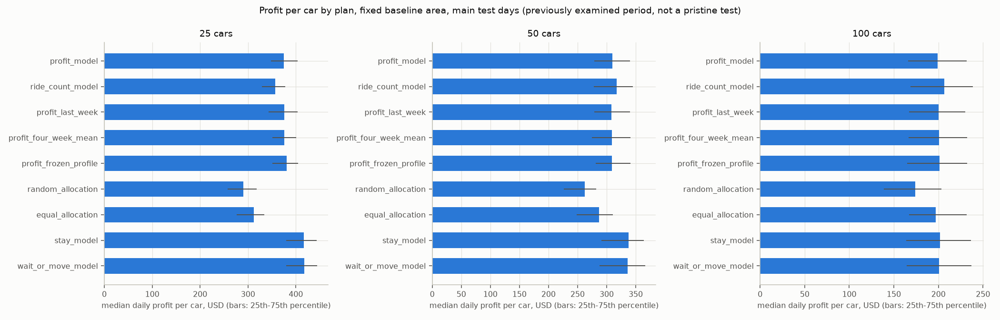

Figure 7.10: Median daily profit per car by plan, fixed baseline area, 57 test days; thin lines show the 25th to 75th percentile range (data/results/fig_h_profit_per_car_by_plan.png). *Previously examined period.*

Figure 7.10 compares all plans. Three things stand out. First, the five profit-based plans, which differ only in the forecast they use, are almost the same height. Second, random and equal allocation are clearly lower at 25 and 50 cars. Third, the two "stay" bars are the highest at 25 and 50 cars.

Table 7.13: Extra comparisons (X) and post hoc comparisons (P), fixed baseline area, 57 main test days

| Comparison (fixed baseline area) | Cars | Median daily difference (USD per car) | Relative gain | Days first plan wins | Holm p (one-sided) |
|---|---:|---:|---:|---:|---:|
| X1 model forecast vs four-week-mean forecast | 25 | -0.9 | -0.2% | 42% | 1.000 |
|  | 50 | 0.0 | 0.0% | 47% | 0.205 |
|  | 100 | -0.3 | -0.1% | 42% | 1.000 |
| X2 model forecast vs frozen-profile forecast | 25 | -3.4 | -0.9% | 26% | 1.000 |
|  | 50 | +0.2 | +0.1% | 54% | 0.288 |
|  | 100 | 0.0 | 0.0% | 54% | 1.000 |
| X3 profit placement vs random allocation | 25 | +85.5 | +29.5% | 100% | below 0.001 |
|  | 50 | +56.1 | +21.3% | 100% | below 0.001 |
|  | 100 | +29.4 | +16.9% | 100% | below 0.001 |
| X4 profit placement vs equal allocation | 25 | +66.5 | +21.3% | 100% | below 0.001 |
|  | 50 | +29.3 | +10.2% | 100% | below 0.001 |
|  | 100 | +2.1 | +1.0% | 75% | below 0.001 |
| P1 profit placement vs stay (post hoc) | 25 | -41.2 | -9.9% | 0% | 1.000 |
|  | 50 | -20.8 | -6.2% | 9% | 1.000 |
|  | 100 | -3.6 | -1.8% | 32% | 1.000 |
| P2 ride-count placement vs stay (post hoc) | 25 | -62.4 | -15.0% | 0% | 1.000 |
|  | 50 | -19.9 | -5.9% | 7% | 1.000 |
|  | 100 | -0.5 | -0.2% | 49% | 0.178 |

(Source: data/results/hypothesis_summary.csv.) *Previously examined period, not a pristine test. Rows P1 and P2 were added after the first look at the test results and are exploratory.*

**Profit placement against random and equal allocation (planned extras).** The profit plan beats random placement on every test day at every fleet size (+17% to +29%) and equal allocation by +21%, +10% and +1% at 25, 50 and 100 cars. So placing cars by expected profit is clearly better than placing them blindly or spreading them evenly, although at 100 cars the gain over equal spreading is small because there are enough cars to cover most zones.

**Post hoc: simply staying put beat profit placement.** This was not planned and is labelled exploratory. A car in the "stay" plan waits where its last trip ended; the day still starts from a placement based on the forecast for hour 0, as for every plan. Staying earned more than profit placement at all three sizes (the profit plan was 9.9%, 6.2% and 1.8% lower at 25, 50 and 100 cars) and more than ride-count placement (15.0% and 5.9% lower at 25 and 50 cars; level at 100 cars). The profit and ride-count plans move cars every hour: about 10 empty relocations per car per day at 25 and 50 cars and 7 at 100 cars (mean of the "moved cars" column divided by the fleet size). Those moves raise the empty-mile share (29.0% against 21.3% for staying at 25 cars) and outweigh whatever extra rides the better position brings. The honest reading is that hourly re-placement was not worth its empty miles in this simulation, and that a simple "stay" rule is a hard benchmark. We did not test a plan that re-places cars only a few times a day.

### 7.2.5 Holidays and the clock-change day

Table 7.14: Paired differences on the days left out of the main test (descriptive only)

| Day group | Hypothesis | Difference, USD per car (25 / 50 / 100 cars) | Relative gain (25 / 50 / 100 cars) |
|---|---|---|---|
| Federal holidays (11 Nov, 28 Nov, 25 Dec) | H2 | -51.5 / -44.4 / -25.0 | -15.0% / -17.3% / -17.6% |
|  | H3 | +22.6 / 0.0 / -0.4 | +7.1% / 0.0% / -0.3% |
|  | H4 | +3.3 / +3.8 / +1.1 | +1.0% / +1.5% / +0.8% |
|  | H5 | +2.4 / -0.2 / +0.2 | +0.7% / -0.1% / +0.2% |
| Clock-change day (3 Nov) | H2 | -103.2 / -120.1 / -77.8 | -28.3% / -40.2% / -45.5% |
|  | H3 | +31.2 / +10.4 / +5.2 | +9.4% / +3.6% / +3.1% |
|  | H4 | +9.5 / +6.0 / +1.0 | +2.7% / +2.1% / +0.6% |
|  | H5 | +2.3 / +0.2 / +0.3 | +0.6% / +0.1% / +0.2% |

(Source: data/results/subgroup_summary.csv.) *Three holidays and one day: far too few for a test, so these are shown as description only. Previously examined period, not a pristine test.*

On the three holidays and on 3 November the signs match the main results: H2 stays strongly negative, H3 is positive at 25 cars only, and H5 is near zero. H4 is slightly positive for all three sizes on these days (+1.0%, +1.5% and +0.8% on the holidays), which points the same way as the forecast study, where the model was clearly better on holidays (section 7.3), but three days cannot confirm it. Splitting the 57 main days into weekdays (40) and weekends (17) gives the same pattern for H2, H3 and H5 as the full set.

### 7.2.6 Sensitivity to price and cost assumptions

Table 7.15: Sensitivity of the relative gains (percent of the second plan's median daily profit) to price and cost assumptions; verdict in brackets (57 main test days, fixed baseline area)

| Scenario | H2: gain % (25 / 50 / 100 cars) | H3: gain % | H4: gain % | H5: gain % |
|---|---|---|---|---|
| Main (price 9.76 + 3.51 per mile; cost 1.36 per mile, 2 per idle hour) | -25.8 / -38.7 / -46.8 **(not supported)** | +5.8 / -0.3 / -2.2 **(not supported)** | +0.1 / +0.3 / 0.0 **(inconclusive)** | 0.0 / -0.2 / 0.0 **(not supported)** |
| Cheaper miles (0.74 per mile) | -22.1 / -35.6 / -44.8 **(not supported)** | -2.2 / -2.7 / -3.7 **(not supported)** | +0.4 / +0.7 / +0.1 **(inconclusive)** | +0.1 / -0.1 / 0.0 **(inconclusive)** |
| Costlier miles (2.00 per mile) | -30.3 / -42.5 / -49.0 **(not supported)** | +16.8 / +3.7 / +1.0 **(supported)** | +0.2 / +0.9 / 0.0 **(inconclusive)** | 0.0 / -0.2 / 0.0 **(not supported)** |
| No idle cost | -22.8 / -33.5 / -37.3 **(not supported)** | +6.1 / +0.1 / -1.5 **(inconclusive)** | 0.0 / +0.2 / 0.0 **(inconclusive)** | 0.0 / -0.2 / 0.0 **(not supported)** |
| High idle cost (5 per hour) | -31.4 / -48.6 / -69.6 **(not supported)** | +5.3 / -0.8 / -3.8 **(not supported)** | +0.1 / +0.4 / +0.1 **(inconclusive)** | +0.1 / -0.2 / 0.0 **(inconclusive)** |
| Nominal price (2.50 + 1.60 per mile) | -2.5 / -10.0 / -14.1 **(not supported)** | +76.6 / +51.1 / +31.6 **(supported)** | +0.3 / -0.1 / +0.3 **(inconclusive)** | -1.1 / -1.5 / -0.2 **(not supported)** |

(Source: data/results/sensitivity_summary.csv.) *Previously examined period, not a pristine test. Settings were not re-tuned for each scenario.*

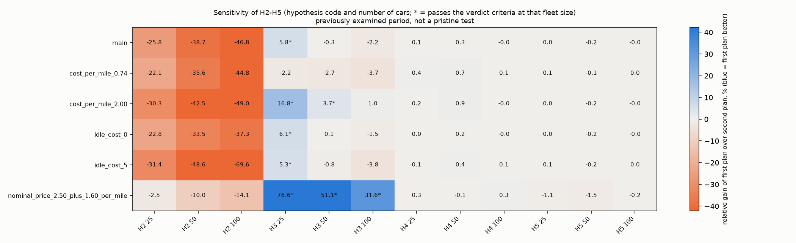

Figure 7.11: Relative gain of the first plan over the second plan for H2 to H5, by scenario and fleet size. Blue means the first plan is better; an asterisk marks a fleet size that passes the verdict criteria (data/results/fig_h_sensitivity.png). *Previously examined period.*

Figure 7.11 shows the same table as a heat map. Three points matter:

- **H2 is not supported in any of the six scenarios.** The data-chosen area from the rough proxy is worse in every case.
- **H3 depends on the price and cost assumptions.** It is supported when miles cost more (2.00 dollars per mile) and under the nominal price, not supported when miles are cheaper (0.74 dollars per mile) or when idle time costs 5 dollars per hour, and inconclusive with no idle cost. This is sensible: when empty miles are expensive, placing cars well matters more.
- **H4 and H5 stay near zero in every scenario** (H4 between -0.1% and +0.9%, H5 between -1.5% and +0.1%), and never reach "supported".

Under the nominal price of 2.50 dollars plus 1.60 dollars per mile, the fleet **loses money**: the median profit per car per day for the profit plan in the fixed area is -9.9, -17.6 and -23.3 dollars at 25, 50 and 100 cars. The percentage gains in that row (for example +76.6%) are therefore percentages of a loss, and they look large only because the base is a loss; the dollar differences (+33.1, +17.6 and +10.4 dollars per car per day for H3) are the safer numbers to read. We also did not try other fleet-size sets in the sensitivity runs, beyond the three frozen sizes.

### 7.2.7 H2b - post hoc follow-up: choosing the launch area with the simulator

**Why this follow-up was added.** The first H2 used a rough proxy score to pick the data-chosen areas (section 5.8), and the proxy uses nominal planning rates and training-period averages. It does not know about the simulator's geofence rule, which drops requests whose trip ends outside the area and so penalises areas that reach into the outer boroughs (Table 7.24). H2 therefore tested "a proxy-chosen area", not "the best area that the data can find". H2b asks a fairer question: if the area is searched with the simulator itself on October validation days, does it beat the fixed Manhattan plus Downtown Brooklyn area on the test days?

**Status and labelling.** H2b is **post hoc and exploratory**: it was added after the H2 result was known, it uses the same previously examined November-December test days, and it is not a pristine test. It does **not** replace or change the H2 verdict, which stays "not supported" for the proxy-chosen areas as pre-registered.

**Method.** The search used the simulator (profit plan with the model forecast, 50 cars, the frozen `requests_per_car_hour` of 4 and `move_ratio` of 0.1, and the calibrated common price) on October 2024 validation days only. It was a seeded stochastic hill climb: repeatedly add, remove or swap one zone and keep the change if the simulated profit per car improves. Every area had to be connected in the river-links graph, hold 30 to 110 zones and at least 30% of training demand, and exclude the ferry-only zones 103 to 105. The search started from three seeds (the fixed baseline, the 60-zone proxy area and the 71-zone proxy area) and scored each area on every third validation day (10 of the 30 days). The 12 best areas and the baseline were then re-scored on all 30 validation days, and the best was frozen. In all, 7,955 areas were scored in 1,508 seconds. The area was saved in `data/results/h2b_frozen_area.json` before any test day was simulated; the search seed was 20261117.

**The area it found.** The chosen area has **84 zones (Manhattan 41, Brooklyn 27, Queens 16)**, of which 45 are also in the fixed baseline, and holds 59.6% of training demand (the fixed area: 41.4%). On the 30 October validation days at 50 cars it earned 404.3 dollars per car per day against 311.1 for the fixed area (Table 7.16). In plain words, it is a bigger footprint than Manhattan plus Downtown Brooklyn: it keeps the Manhattan core, drops many northern and edge Manhattan zones, and adds much of western Brooklyn and western Queens.

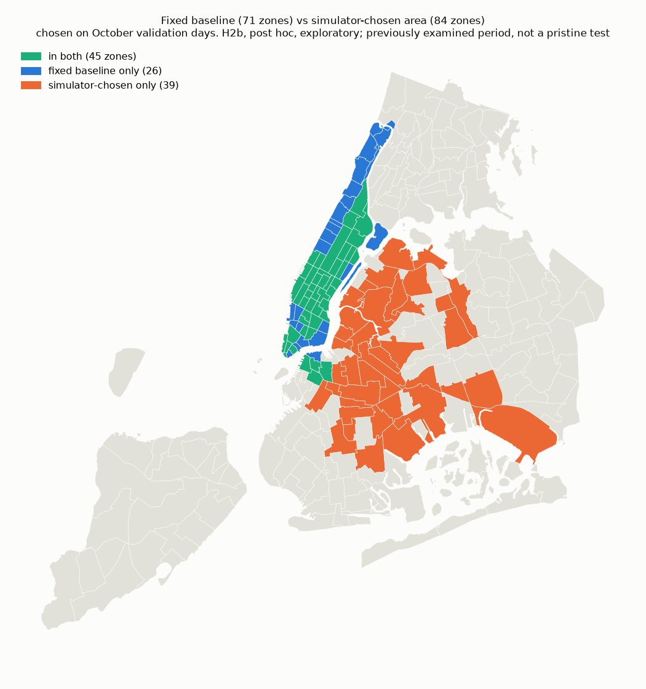

Figure 7.12: The fixed baseline (71 zones) and the simulator-chosen area (84 zones): zones in both (green, 45), baseline only (blue, 26) and simulator-chosen only (orange, 39) (docs/report_assets/fig_h2b_area_map.png). *H2b, post hoc, exploratory; the area was chosen on October validation days.*

Figure 7.12 shows that the simulator-chosen area is a more compact block than the patchy proxy areas of Figure 7.11: it covers the southern and central Manhattan core, joined across the East River to a wide band of Brooklyn and western Queens.

**Result on the test days.** On the 57 main test days, the simulator-chosen area earned more than the fixed area at every fleet size and on every one of the 57 days, with the profit plan and the model forecast in both (chosen minus baseline, Holm correction over the three fleet sizes). Under the verdict rule written before the H2 test, H2b would be **supported** at all three sizes.

Table 7.16: H2b results: simulator-chosen area against the fixed area (post hoc, exploratory; 57 main test days)

| Fleet size | Validation profit per car per day, chosen / fixed (USD) | Test median profit per car per day, chosen / fixed (USD) | Median daily difference (USD per car) | Relative gain | 95% interval of the median | Days chosen wins | Holm p | Result |
|---|---:|---:|---:|---:|---:|---:|---:|---|
| 25 cars | 438.7 / 376.5 | 441.0 / 374.6 | +62.6 | +16.7% | 56.9 to 68.6 | 100% | below 0.001 | passes |
| 50 cars | 404.3 / 311.1 | 399.7 / 309.5 | +93.4 | +30.2% | 86.2 to 98.3 | 100% | below 0.001 | passes |
| 100 cars | 319.5 / 196.9 | 323.2 / 198.9 | +121.2 | +60.9% | 116.2 to 126.9 | 100% | below 0.001 | passes |

(Source: data/results/h2b_test_results.csv and h2b_frozen_area.json; Holm p about 7.7e-11 at each size.) *H2b, post hoc, exploratory; previously examined period, not a pristine test.*

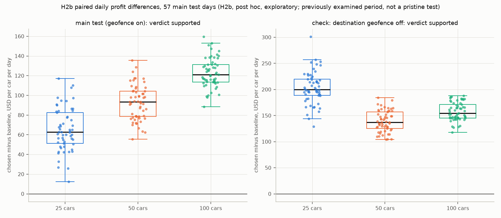

Figure 7.13: Daily profit difference per car, simulator-chosen area minus fixed area, on the 57 main test days. Left: the main test (geofence on). Right: a crude check with the destination geofence switched off (docs/report_assets/fig_h2b_paired_differences.png). *H2b, post hoc, exploratory; previously examined period.*

Figure 7.13 shows one dot per test day. Every dot is above zero in both panels, so the gain was not driven by a few unusual days.

**Why the chosen area earns more, and what the geofence did.** Table 7.17 compares the two areas in the simulator. The geofence drops a smaller share of requests in the chosen area than in the fixed one (24.5% against 27.0%), so the first H2 failure was not simply a geofence penalty on any area outside Manhattan; it was the proxy choosing poor areas. The chosen area serves a *smaller* share of the requests that start in it (0.18, 0.36 and 0.59 against 0.29, 0.50 and 0.67 for the fixed area), but it earns more because it has 43% more requests per day (3,957 against 2,760) for the same fleet, and its served trips are longer (about 4.0 to 4.6 miles against 2.7 miles per served trip, so about 24 to 26 dollars of revenue per trip against about 19). The cars are also busier (utilisation 58%, 55% and 43% against 51%, 44% and 27%).

Table 7.17: Fixed area against the simulator-chosen area in the simulator (profit plan, 57 main test days)

| Cars | Area | Requests starting in the area per day | Dropped by the geofence | Served share | Mean utilisation | Median profit per car per day (USD) |
|---:|---|---:|---:|---:|---:|---:|
| 25 | Fixed baseline (71 zones) | 2,760 | 27.0% | 28.8% | 50.7% | 374.6 |
|  | Simulator-chosen (84 zones) | 3,957 | 24.5% | 18.4% | 58.3% | 441.0 |
| 50 | Fixed baseline (71 zones) | 2,760 | 27.0% | 49.8% | 43.9% | 309.5 |
|  | Simulator-chosen (84 zones) | 3,957 | 24.5% | 36.2% | 55.0% | 399.7 |
| 100 | Fixed baseline (71 zones) | 2,760 | 27.0% | 66.7% | 27.2% | 198.9 |
|  | Simulator-chosen (84 zones) | 3,957 | 24.5% | 58.6% | 42.7% | 323.2 |

(Source: data/results/h2b_geofence_summary.csv; miles and revenue per served trip from h2b_daily_results.csv.) *H2b, post hoc, exploratory; previously examined period, not a pristine test.*

**Robustness check.** As a crude check, the destination geofence was switched off inside the script (by temporarily replacing the simulator's area-keeping step so that only the pickup zone must be in the area). The simulator-chosen area still earned more at every fleet size: +199.9, +137.1 and +154.8 dollars per car per day at 25, 50 and 100 cars, and all three pass the rule. This check is crude (it lets cars take trips that end anywhere) and is shown only to say that the H2b gain does not depend on the geofence rule.

**What H2b does and does not show.** The idea of a data-chosen launch area is **not refuted**: the first H2 failed mainly because the rough proxy chose poor areas, and an area found with the simulator is a bigger Manhattan, Brooklyn and Queens footprint covering about 60% of demand that earned clearly more than the fixed area. But there are strong reasons to read this with care:

- It is post hoc and exploratory, and it is tested on the same previously examined November-December days.
- About 8,000 areas were tried on October days, so the validation gain (+93 dollars per car per day at 50 cars) is optimistic. The test gain at 50 cars was similar (+93.4), which is reassuring.
- Profit per car at a fixed fleet rewards areas with more demand per car and longer trips, and the chosen area is larger (84 against 71 zones, 60% against 41% of demand). So this is not a pure "better zones" result: part of it is simply a larger market for the same number of cars, and the comparison does not hold the number of requests per car constant.
- The simulator is run at 1% demand scale with one seed per day and a calibrated common price, and its geofence and polygon-only adjacency still apply.

## 7.3 Forecast results and comparison of approaches

**Setup.** The final forecast (Phase 3b) uses demand lags of 7, 14, 21 and 28 days of the same zone, the civil weekday and hour, and other known-ahead inputs (Table 5.6). Gradient boosting was tuned on September 2024, the count-bias scale of 1.0213 was fitted on 1 to 15 October, and the method was chosen on 16 to 31 October. The frozen choice is the **plain four-week mean**.

Table 7.18: Late-October validation, 16 to 31 October 2024 (100,992 zone-hours; used to choose)

| Method | MAE | RMSE | WAPE % |
|---|---:|---:|---:|
| Mean of previous 4 weeks (**selected**) | 12.52 | 26.35 | 12.08 |
| Model, scaled | 12.80 | 27.50 | 12.35 |
| Model, raw | 13.21 | 28.50 | 12.74 |
| Last week | 14.97 | 30.69 | 14.44 |
| Frozen 28-day profile | 17.11 | 35.32 | 16.51 |
| Frozen 7-day profile | 20.42 | 42.19 | 19.70 |

(Source: data/forecasts/forecast_summary.json; MAE and RMSE in requests per zone-hour.) On the validation days the plain four-week mean was best, so it was frozen as the choice.

Table 7.19: Diagnostic re-check, November to December 2024 (383,717 identical rows for every method; **not a pristine test**)

| Method | MAE | RMSE | WAPE % |
|---|---:|---:|---:|
| Model, scaled | 18.93 | 39.58 | 17.99 |
| Model, raw | 19.07 | 39.64 | 18.12 |
| Mean of previous 4 weeks (frozen choice) | 19.21 | 40.90 | 18.25 |
| Frozen 28-day profile | 22.51 | 45.04 | 21.38 |
| Last week | 23.11 | 49.44 | 21.95 |
| Frozen 7-day profile | 25.19 | 50.31 | 23.93 |

(Source: forecast_summary.json.)

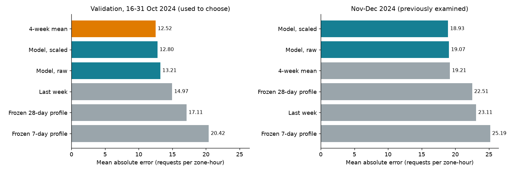

Figure 7.14: Mean absolute error by method on the late-October validation days (left) and on November to December 2024 (right). Lower is better.

**Reading.** The model's error is about 18% lower than copying last week (18.93 against 23.11) and about 1.5% lower than the plain four-week mean (18.93 against 19.21). It beats the four-week mean on 33 of the 61 days, which is effectively a tie. The learned model is therefore not clearly better than simple history overall. Table 7.20 and Figure 7.15 show where it does help: federal holidays.

Table 7.20: Nov-Dec 2024 error by day type and demand group (MAE, requests per zone-hour; WAPE % in brackets)

| Group | Model, scaled | Mean of previous 4 weeks | Last week |
|---|---|---|---|
| Normal days | 18.40 (17.33) | 18.28 (17.22) | 22.21 (20.92) |
| Federal holidays | 29.19 (33.20) | 37.21 (42.31) | 40.47 (46.02) |
| Low-demand zones | 4.02 (26.88) | 3.86 (25.76) | 4.63 (30.97) |
| Lower-middle zones | 11.06 (18.28) | 11.04 (18.25) | 13.41 (22.17) |
| Upper-middle zones | 18.97 (16.46) | 19.50 (16.92) | 23.38 (20.29) |
| High-demand zones | 41.69 (18.08) | 42.46 (18.42) | 51.01 (22.12) |

(Source: forecast_summary.json, `nov_dec_by_group`.) On the 18,936 federal-holiday zone-hours the model's MAE is 29.2 against 37.2 for the four-week mean, because it can use the holiday flag and holidays of the lagged days. Relative error (WAPE) is highest in the lowest-demand zones for all methods.

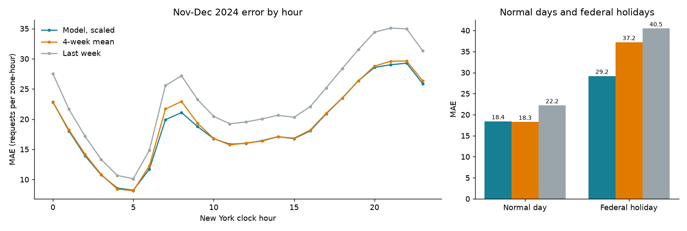

Figure 7.15: Nov-Dec 2024 forecast error by New York clock hour (left) and on normal days versus federal holidays (right). Error is largest in the evening and on holidays.

By month, the model's MAE is 16.53 in November and 21.25 in December, against 16.78 and 21.56 for the four-week mean (forecast_summary.json). Uncertainty intervals were not produced for the forecast, and no calibration check of intervals exists.

**Which forecast the simulator uses.** The simulator's headline "forecast plan" uses the gradient-boosting forecast with its count-bias scale, not the plain four-week mean that the forecast study froze. The copy-last-week, four-week-mean and frozen 28-day-profile plans are run as comparisons on the same days (section 7.2.4). Where the last-week or four-week values were missing (hour 1 on four Sundays, because the 3 November counts are missing) the frozen profile was used.

An earlier calendar-only experiment (Random Forest and gradient boosting without demand lags) and a first lag-based experiment were superseded by this final design (decisions 2026-11-15 [@decisions]); their scores are not used in this report.

## 7.4 Explaining the forecast with SHAP

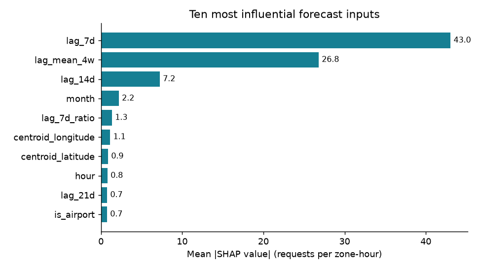

Figure 7.16: The ten inputs with the largest mean absolute SHAP value for the gradient-boosting forecast (TreeExplainer; forecast_summary.json).

Table 7.21: Top forecast inputs by mean absolute SHAP value

| Input | Mean abs SHAP (requests per zone-hour) |
|---|---:|
| `lag_7d` (demand 7 days earlier) | 43.0 |
| `lag_mean_4w` (mean of the four previous weeks) | 26.8 |
| `lag_14d` | 7.2 |
| `month` | 2.2 |
| `lag_7d_ratio` | 1.3 |
| `centroid_longitude` | 1.1 |
| `centroid_latitude` | 0.9 |
| `hour` | 0.8 |
| `lag_21d` | 0.7 |
| `is_airport` | 0.7 |

The model relies mostly on the zone's own recent history: last week's demand, the four-week mean and the demand two weeks earlier. Calendar and location fields come far behind. This matches the finding in section 7.3 that a four-week mean is already hard to beat. SHAP shows what the model uses, not what causes demand [@molnar].

## 7.5 Launch-area and simulator results

### 7.5.1 Common price fitted to recorded fares

The common price was fitted to recorded fares: a base charge of **9.76 dollars plus 3.51 dollars per passenger mile**, with R-squared 0.957 against recorded fares (mean recorded fare 25.52 dollars; 1,472,882 training zone-hours used). The simulator also uses a detour factor of 1.40 and an average speed of 14.6 mph for pairs without enough training trips (Table 5.8). This price is a calibration so that simulated revenue is realistic. It is **not** a pricing proposal, and riders are assumed not to react to it. The nominal planning rates of 2.50 dollars plus 1.60 dollars per mile are used for the launch-area search proxy and as a sensitivity run (section 7.2.6).

### 7.5.2 Neighbour graph and launch-area candidates

Table 7.22: Connected groups of zones for three versions of the neighbour graph

| Graph | Connected groups |
|---|---:|
| Polygon neighbours only (no links) | 10 |
| Plus 30 river-crossing links | 5 |
| Plus river-crossing and 5 airport-road links | 4 |

(Source: data/launch_area/connected_groups.csv.)

The search finds the connected area of a given size with the highest proxy score. The proxy is the expected profit per car-hour for a nominal fleet of 1,000 cars, computed from training data only, at the nominal rates of 2.50 dollars plus 1.60 dollars per mile. Table 7.23 shows the results for the main graph (river-crossing links).

Table 7.23: Launch areas from the training-data proxy (main graph: river-crossing links)

| Area | Zones | Boroughs | Share of training demand | Proxy profit per car-hour (nominal rates, 1,000 cars) |
|---|---:|---|---:|---:|
| Fixed baseline (Manhattan plus Downtown Brooklyn) | 71 | Manhattan 66, Brooklyn 5 | 41.4% | 3.63 |
| Proxy-optimal 15 | 15 | Queens 7, Manhattan 7, Brooklyn 1 | 13.0% | 2.56 |
| Proxy-optimal 30 | 30 | Manhattan 14, Brooklyn 10, Queens 4, Bronx 2 | 23.6% | 4.42 |
| Proxy-optimal 60 | 60 | Manhattan 24, Brooklyn 19, Queens 13, Bronx 4 | 37.3% | 5.78 |
| Proxy-optimal 71 | 71 | Manhattan 23, Brooklyn 20, Queens 16, Bronx 12 | 39.0% | 5.95 |

(Source: data/launch_area/launch_areas_summary.csv. The proxy uses nominal planning rates, not the fitted price, so the last column ranks areas but is not a profit forecast. The proxy constants are nominal and the proxy knows nothing about the simulator's geofence rule.)

The areas the proxy prefers are not Manhattan-centred. At the same size of 71 zones it picks a mix of Manhattan, Brooklyn, Queens and the Bronx with a higher proxy score than the fixed baseline, even though it covers slightly less of the demand (39.0% against 41.4%). The full simulator did not agree with the proxy (section 7.5.3).

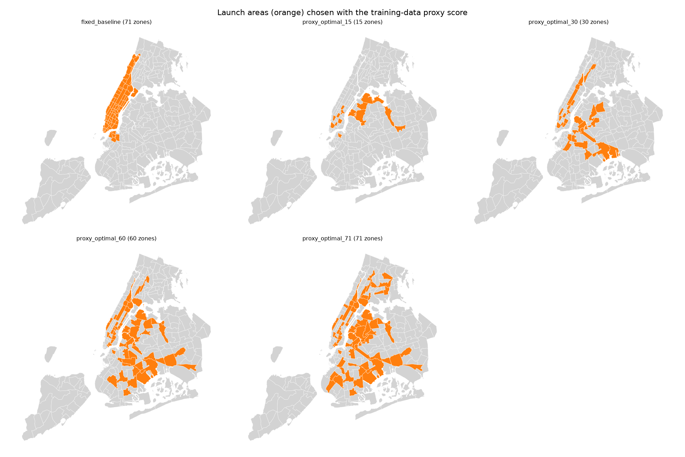

Figure 7.17: Launch areas (orange) chosen with the training-data proxy score, compared with the fixed baseline (top left) (data/launch_area/launch_areas_map.png).

Figure 7.17 shows the fixed baseline (top left) as one compact block along Manhattan, and the proxy-chosen areas of 15, 30, 60 and 71 zones as patchy collections of busy zones scattered over Manhattan, Brooklyn, Queens and the Bronx, with gaps in between. The patches are connected only through the bridge and tunnel links. Because the simulator's matching and repositioning use polygon neighbours only, cars cannot actually drive across a river in the simulation; the links were used only to build connected launch areas (section 7.12).

### 7.5.3 What happened in the simulator

Table 7.24: Fixed baseline area against the data-chosen area, profit plan with the model forecast (57 main test days)

| Cars | Launch area | Median profit per car per day (USD) | Share of all requests starting in the area | Of those, dropped because the trip ends outside | Ceiling on served share | Mean served share | Mean utilisation |
|---:|---|---:|---:|---:|---:|---:|---:|
| 25 | Fixed baseline (71 zones) | 374.6 | 41.1% | 27.0% | 73.0% | 29.3% | 50.7% |
|  | Data-chosen (60 zones) | 268.4 | 37.0% | 55.0% | 45.0% | 24.0% | 37.7% |
| 50 | Fixed baseline (71 zones) | 309.5 | 41.1% | 27.0% | 73.0% | 50.4% | 43.9% |
|  | Data-chosen (71 zones) | 190.2 | 38.8% | 55.6% | 44.4% | 33.8% | 29.4% |
| 100 | Fixed baseline (71 zones) | 198.9 | 41.1% | 27.0% | 73.0% | 67.0% | 27.1% |
|  | Data-chosen (71 zones) | 105.9 | 38.8% | 55.6% | 44.4% | 41.0% | 15.3% |

(Source: data/results/daily_results.csv.) *Previously examined period, not a pristine test. "Share of all requests starting in the area" uses the 1%-scaled simulated requests. "Ceiling on served share" is 100% minus the share dropped by the geofence rule.*

Two things explain why the proxy-chosen areas lost. First, the fixed baseline area holds about 41% of all requests, against 37% to 39% for the chosen areas. Second, and more important, **27% of requests that start in the baseline area end outside it and are dropped, against 55% to 56% in the chosen areas**. The Manhattan-centred area keeps more trips inside; the spread-out areas lose more than half of theirs. As a result, the best a fleet could ever serve is about 73% of requests in the baseline area but only about 45% in the chosen areas, and utilisation was lower too (for example 37.7% against 50.7% at 25 cars).

This is a feature of the simulator's geofence rule and not necessarily of real operations, where a car could finish a trip outside the area and return empty. It does not make the H2 verdict wrong, but it limits what H2 can say about spread-out, outer-borough launch areas. The H2b follow-up (section 7.2.7) shows that the geofence was not the whole story: an 84-zone area chosen with the simulator drops fewer requests (24.5%) than the fixed area (27.0%) and earns clearly more.

*Candidate areas for a pilot* (from Table 7.23 and section 7.2.7) are therefore of three kinds: the Manhattan-plus-Downtown-Brooklyn area, which beat every proxy-chosen area in every simulator run; the proxy-optimal areas, which did worse here; and the 84-zone Manhattan, Brooklyn and Queens area found with the simulator, which did best but is a post hoc, exploratory result.

## 7.6 Fairness: the service gap

The design asks for a minimum service level in every zone and a service gap between low- and high-demand zones. The simulator **reports** these numbers but does **not enforce** a minimum, so a plan can leave a quiet zone with no service at all. Here the **service gap** is the share of requests served in the high-demand zones minus the share served in the low-demand zones (a positive gap means busy zones are served better). The **lowest-zone share** is the served share of the worst-served zone over the 57 test days. Demand groups are the four equal-count groups of Table 7.4. The simulator does not model waiting; a request is either picked up by a nearby free car or lost, so no waiting-time results exist.

Table 7.25: Service gap and lowest-zone share by plan, fixed baseline area (57 main test days)

| Plan | Gap, 25 cars | Lowest zone, 25 cars | Gap, 50 cars | Lowest zone, 50 cars | Gap, 100 cars | Lowest zone, 100 cars |
|---|---:|---:|---:|---:|---:|---:|
| Profit placement (model forecast) | +0.010 | 0.000 | +0.103 | 0.031 | +0.017 | 0.180 |
| Ride-count placement | +0.140 | 0.010 | +0.130 | 0.010 | +0.042 | 0.021 |
| Equal allocation | -0.051 | 0.000 | -0.038 | 0.010 | -0.017 | 0.850 |
| Random allocation | +0.012 | 0.104 | +0.007 | 0.271 | +0.002 | 0.607 |
| Cars stay put | +0.044 | 0.083 | +0.053 | 0.323 | +0.043 | 0.382 |
| Wait-or-move rule | +0.047 | 0.056 | +0.056 | 0.278 | +0.046 | 0.393 |

(Source: data/results/fairness_summary.csv. Gap = served share in high-demand zones minus low-demand zones; lowest zone = served share of the worst-served of 70 zones over the period.) *Previously examined period, not a pristine test. Minimum service level reported, not enforced.*

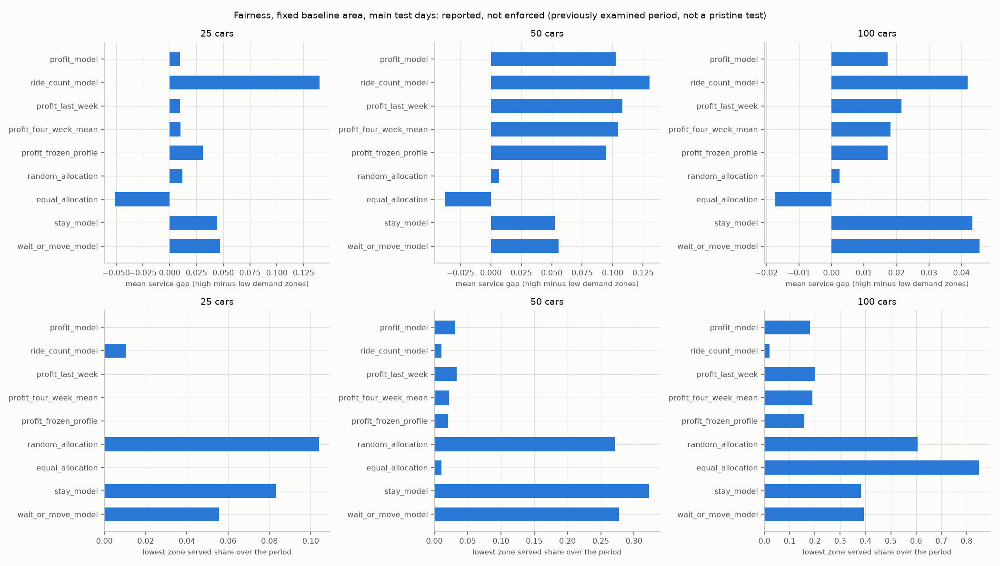

Figure 7.18: Mean service gap (top row) and lowest-zone served share (bottom row) by plan and fleet size, fixed baseline area (data/results/fig_h_service_fairness.png). *Previously examined period.*

Figure 7.18 shows the same numbers as bars. Reading them together:

- **Ride-count placement has the largest gap** (+0.140, +0.130 and +0.042 at 25, 50 and 100 cars). It sends cars to the busiest zones, so busy zones are served much better than quiet ones.
- **Profit placement and equal allocation have smaller gaps.** The profit plan is at +0.010, +0.103 and +0.017, and equal allocation is slightly negative (-0.051, -0.038 and -0.017), meaning quiet zones are served a little better. Random allocation is close to zero (0.001 to 0.012) but earns much less (section 7.2.4). At 50 cars the profit plan's gap (+0.103) is not far from the ride-count plan's (+0.130).
- **At 25 cars a zone can go entirely unserved.** Under profit placement and equal allocation, the lowest-zone share is 0.000: one of the 70 zones received no served trip in the 57 days. Ride-count placement reaches 0.010.
- **Equal allocation has the best lowest-zone share at 100 cars** (0.85, against 0.18 for the profit plan and 0.02 for ride-count placement) and costs little profit there: the profit plan beats it by only 1.0% (Table 7.13, row X4). A service floor may therefore be affordable with a large fleet and expensive with a small one.
- **A busy-zone advantage is not a fairness failure by itself.** At 50 cars the profit plan serves 71.9% of requests in high-demand zones and 61.6% in low-demand zones; the difference reflects where the cars are, and we did not study whether it harms any group of riders.

*Mean service gaps are shown only for the fixed baseline area. In the data-chosen areas the same pattern holds (fairness_summary.csv), but with lower served shares because of the geofence rule.* No plan was designed to meet the minimum-service design condition, so none can be said to meet it; the numbers show what to watch. The forecast also has its largest relative error in the lowest-demand zones (WAPE 26.9% for the model there against 16.5% to 18.3% elsewhere; Table 7.20).

## 7.7 Drift check, January 2025

January 2025 is drift-only: it is never used for tuning or selection. The forecast file contains predictions for January 2025, but they were not scored, fitted or used for selection before this check (forecast_summary.json). The rules below were written before the January numbers were computed (src/drift_monitor.py, decisions 2026-11-16). The check is a runnable script (`notebooks/07_drift_check.py`) with no random numbers; it writes its tables and figures to `data/drift/`. The scope is **reduced**: it checks the data and the forecast error. It does not re-run the fleet simulator on January 2025, so there is no plan ranking for that month.

**Data drift did not fire.** We compare six inputs (the hourly request count, the hour-of-day profile and the demand lags of 7, 14, 21 and 28 days) of the reference period (January to October 2024) with November-December 2024 and with January 2025, using the Population Stability Index (PSI). A PSI above 0.1 means "watch" and above 0.2 means "alert". Every PSI was below 0.01; the largest for January 2025 was 0.0027 (the 28-day lag) (Figure 7.19). The shape of the day was also steady (Figure 7.20), though January 2025 had slightly higher peaks at 8:00 and 17:00 to 18:00 and a lower late-evening share. Mean demand per zone-hour in January 2025 was 103.2, against 99.5 in January 2024.

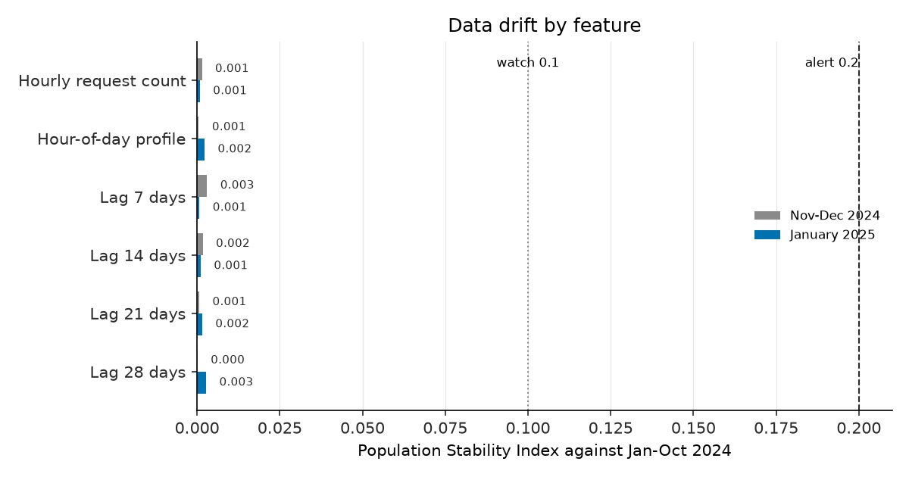

Figure 7.19: Population Stability Index for six inputs, November-December 2024 (grey) and January 2025 (blue), against the January-October 2024 reference. The "watch" and "alert" lines are at 0.1 and 0.2; all bars are too small to see (data/drift/fig_drift_psi_by_feature.png).

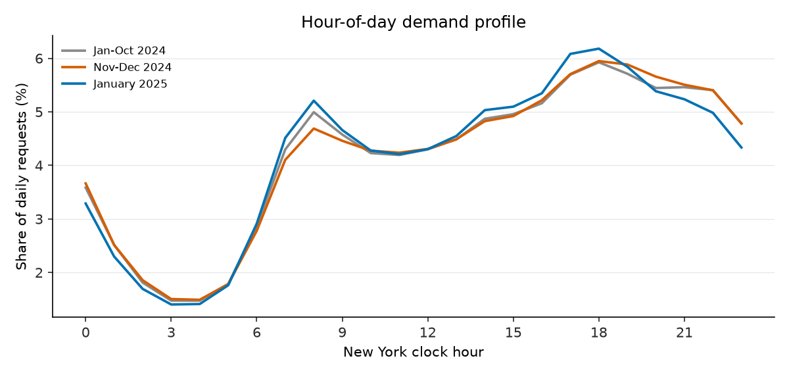

Figure 7.20: Share of daily requests by New York clock hour: January to October 2024 (grey), November-December 2024 (orange) and January 2025 (blue) (data/drift/fig_drift_hour_profile.png).

**Error drift fired.** The alert rule is: the weekly WAPE of the frozen model is more than 25% above its October 2024 level (12.3%, so the limit is 15.4%) for two weeks in a row (weeks with at least five days). Table 7.26 lists the weeks.

Table 7.26: Weekly forecast error of the frozen model against the alert limit (weeks starting 18 November 2024 to 27 January 2025)

| Week starting (Monday) | Weekly WAPE, frozen model | Bias | Over the 15.4% limit | Alert week |
|---|---:|---:|---|---|
| 2024-11-18 | 13.0% | -5.6% | no | no |
| 2024-11-25 | 25.8% | +5.2% | yes | no |
| 2024-12-02 | 15.4% | -9.4% | no | no |
| 2024-12-09 | 15.0% | -9.2% | no | no |
| 2024-12-16 | 13.5% | -1.9% | no | no |
| 2024-12-23 | 36.8% | +23.2% | yes | no |
| 2024-12-30 | 30.3% | +8.0% | yes | yes |
| 2025-01-06 | 20.0% | -2.7% | yes | yes |
| 2025-01-13 | 16.9% | -3.5% | yes | yes |
| 2025-01-20 | 16.2% | -6.5% | yes | yes |
| 2025-01-27 | 12.9% | +2.8% | no | no |

(Source: data/drift/weekly_error.csv; bias = predicted minus actual, as a share of actual.) *Weeks from 18 November to 23 December belong to the previously examined period; the weeks from 30 December onward are the drift period.*

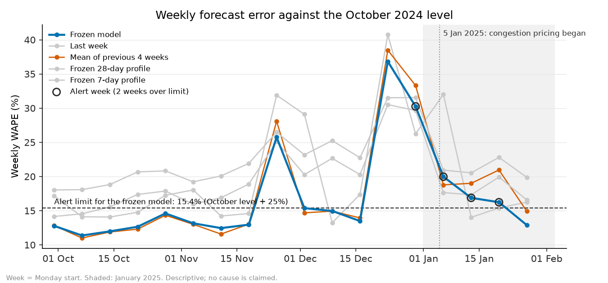

Figure 7.21: Weekly forecast error (WAPE) of the frozen model and four simple methods against the alert limit of 15.4% (October level plus 25%). Circles mark alert weeks (data/drift/fig_drift_weekly_wape.png). Descriptive; no cause is claimed.

Figure 7.21 and Table 7.26 show that the error was close to the October level through most of November and December, jumped in the weeks that contain Thanksgiving (25 November: 25.8%), Christmas (23 December: 36.8%) and New Year (30 December: 30.3%), and then stayed above the limit in the first three weeks of January (20.0%, 16.9% and 16.2%) before falling back to 12.9% in the week of 27 January. The first alert week is 30 December, a week that includes New Year's Day; the run of weeks over the limit began on 23 December. The simple methods show the same spikes (the four-week mean also first alerts on 30 December, and copy-last-week alerts earlier, on 2 December), so this is not a weakness peculiar to the learned model. In plain words: **the forecast is reliable on ordinary weeks and degrades around holidays, and the monitor correctly flagged that.** A plausible reading, which we did not test, is that the alert is largely a holiday effect, because the model's lags look back at ordinary weeks and cannot know about the holidays; but we cannot separate it from other changes in January.

**Congestion-pricing caveat.** The Manhattan central-business-district congestion fee (`cbd_congestion_fee`) is cleanly visible in the January 2025 data from 5 January: 0.0% of trips carry it on 1 to 3 January, 33.3% on 5 January and 35.1% afterwards; 6,300,212 of 20,405,666 January 2025 trips (30.9%) carry it (audit section 3.7 [@audit]). The column does not exist in the 2024 files. As a descriptive check, we defined a "congestion-zone proxy" of the 44 Manhattan zones whose centroid lies south of latitude 40.7685, and compared demand with the same weekdays a year earlier (index 1.0 means the same demand):

Table 7.27: January 2025 demand index (same weekdays 364 days earlier) and model error in the congestion-zone proxy and the other zones

| Window | Demand index, congestion-zone proxy | Demand index, other zones | Model bias, congestion-zone proxy | Model bias, other zones | WAPE, congestion-zone proxy | WAPE, other zones |
|---|---:|---:|---:|---:|---:|---:|
| 1 to 4 January | 0.92 | 1.05 | +18.8% | +7.5% | 38.8% | 29.1% |
| 5 to 31 January | 0.96 | 1.05 | -8.7% | -0.1% | 18.9% | 16.1% |
| For reference: October 2024 | n/a | n/a | -3.1% | -1.4% | 11.6% | 12.6% |

(Source: data/drift/drift_summary.json and error_by_window_and_zone_group.csv.)

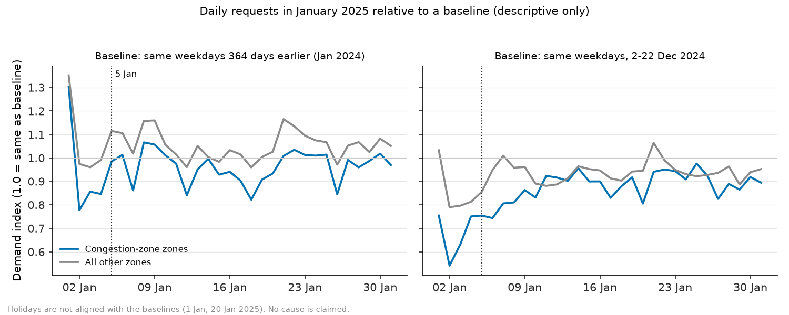

Figure 7.22: Daily January 2025 requests relative to the same weekdays a year earlier (left) and to 2 to 22 December 2024 (right), for the congestion-zone proxy (blue) and all other zones (grey); the dotted line is 5 January (data/drift/fig_drift_congestion_index.png). Descriptive only.

Demand in the congestion-zone proxy was about 4% to 8% below its level a year earlier while other zones were about 5% above, and the model over-predicted the zone in the first days of January (+18.8%) and under-predicted it after 5 January (-8.7%). This is a description of what the data show. **We make no causal claim about congestion pricing**: January 2025 also differs in season, holidays and weather from the year before, the holidays are not aligned with the baselines (1 and 20 January), and the zone is a rough proxy for the real charging area.

## 7.8 Validation, testing, cross-validation and tuning

**Time-ordered validation instead of cross-validation.** Random cross-validation would mix past and future days, so the project uses time-ordered windows only: train on January to August, tune on September, calibrate on 1 to 15 October, choose on 16 to 31 October, and compare on November to December (Table 5.9).

Table 7.28: Hyperparameter tuning on September 2024 (189,360 zone-hours)

| Candidate | MAE | RMSE | WAPE % |
|---|---:|---:|---:|
| Squared-error loss, small (**chosen**) | 15.01 | 30.17 | 14.94 |
| Squared-error loss, large | 15.04 | 30.28 | 14.97 |
| Poisson loss, large | 15.05 | 30.40 | 14.99 |
| Poisson loss, small | 15.10 | 30.45 | 15.04 |

(Source: forecast_summary.json.) The four candidates are within 0.6% of each other, so the model is not sensitive to these settings.

**Testing.** The Phase 1 code has 57 unit tests that pass (Linux, Java 17, Python 3.11), and `ruff` passed at the Phase 1 receipt. The EDA and first forecast notebooks added 22 focused tests that pass. The repository also contains tests for the demand features, the simulator and the launch-area search. [PENDING P-25: final test count and `ruff` status on the final branch, and the commit hash of the submitted state.]

**Independent data verification.** The release was verified against the raw files by a team member other than its author (Table 3.5). That check found the neighbour-table bug, which was fixed.

## 7.9 Application outputs: the forecast service and experiment log

The pre-submission plan was a forecast API in Docker with MLflow tracking, drift monitoring and a fairness check. The final scope was reduced (deviation 8 in Table 2.5), and what was built is listed below.

| Part of the plan | Status |
|---|---|
| Forecast API | Built: a small FastAPI service in `service/` with `GET /health` and `POST /forecast` |
| Docker | The image was built and the container run and tested (build steps in `service/README.md`) |
| MLflow tracking | Local logging works: `notebooks/07_mlflow_tracking.py` copies the frozen settings, scores and drift summary into a local run in `mlruns/` (git-ignored); runs are tagged "previously examined" |
| Drift monitoring | Done in reduced form: data and error drift on January 2025 (section 7.7), no live monitoring |
| Fairness check | Done in the simulation (section 7.6), reported and not enforced |
| Not built | A live data feed, retraining, a user interface, authentication, and a re-run of the fleet simulator on January 2025 |

**What the service does.** It answers "how many requests will zone Z get in each of the next H hours?" using the frozen gradient-boosting model. The inputs are built by the same code as in training (`src/demand_features.py`): the counts of the same zone and clock hour 7, 14, 21 and 28 days earlier, plus calendar and zone location. Counts from the last 7 days before a requested hour are never read. The request is a zone number, a start time exactly on the hour and a number of hours (1 to 168). The answer lists, for each hour, the predicted requests, the four-week-mean reference and how many lags were available. Unknown zones return an error (404); a start time that is not on the hour, or hours with no lag counts in the history, return a 422 error.

**Example (real output).** The request and response below were produced by running the service in-process on the demo history, for zone 161 (Midtown Center) from 12:00 UTC on 15 January 2025 for three hours:

```
POST /forecast   {"zone_id": 161, "start_utc": "2025-01-15T12:00:00Z", "hours": 3}

200 OK
{"zone_id": 161, "model_file": "frozen_model.joblib", "history_last_date": "2025-01-31",
 "forecasts": [
   {"hour_start_utc": "2025-01-15T12:00:00Z", "predicted_requests": 93.75,  "four_week_mean_reference": 85.75,  "lags_available": 4},
   {"hour_start_utc": "2025-01-15T13:00:00Z", "predicted_requests": 116.3,  "four_week_mean_reference": 114.5,  "lags_available": 4},
   {"hour_start_utc": "2025-01-15T14:00:00Z", "predicted_requests": 165.03, "four_week_mean_reference": 145.25, "lags_available": 4}],
 "warning": null}
```

`GET /health` returns the status, the model file, 263 zones, 28 model inputs and the first and last dates of the history held (1 December 2024 to 31 January 2025). To run the service without Docker, install `service/requirements.txt` and start it with `uvicorn --factory service.forecast_api:create_app_from_environment --port 8000` from the repository root; the Docker steps are in `service/README.md`.

**Limits.** The service reads a fixed snapshot of past counts (`service/sample_history.csv.gz`, 1 December 2024 to 31 January 2025). It is a demonstration, not a live system: a real deployment would need a live feed of finished-trip counts cleaned by the Phase 1 rules and complete up to 7 days before each requested hour. The service does not retrain or update the model. We took no screenshot; the text above is the actual request and response.

## 7.10 Interpretation, key findings and recommendations

**Key findings.** All simulator findings are about the previously examined November-December 2024 period, in a simulation on a proxy of robotaxi demand, and are associations under the stated assumptions.

- **Demand is very uneven and stable.** The top 10 of 263 zones hold 13.33% of summed demand, and the zone and hour differences are large and stable week to week (H1 supported within an exploratory design).
- **A forecast is useful, but adds little to placement.** A forecast that uses only demand at least seven days old has about 18% lower error than copying last week, about 1.5% lower error than a plain four-week mean (a tie) and clearly lower error on federal holidays (MAE 29.2 against 37.2). In the fleet simulation, however, forecast-guided placement earned at most 0.3% more than copy-last-week (H4 inconclusive), and the model forecast was level with the four-week-mean and frozen-profile forecasts.
- **Placing cars by expected profit clearly beats placing them blindly.** The profit plan earned 17% to 29% more than random placement and 1% to 21% more than equal allocation, on every test day for random placement and on 75% to 100% of days for equal allocation.
- **But simple rules are competitive.** Ride-count placement matched or beat the profit plan at 50 and 100 cars in the baseline area (H3 not supported; the profit plan wins clearly only at 25 cars, +5.8%). Simply leaving cars where their last trip ended beat hourly re-placement by 9.9%, 6.2% and 1.8% at 25, 50 and 100 cars (post hoc, exploratory), because hourly re-placement costs about 10 empty relocations per car per day at the two smaller fleet sizes.
- **Moving free cars to busier neighbours did not pay.** The wait-or-move rule gained about 0% (H5 not supported), and on the October validation days moving more often was clearly worse.
- **The launch area is the biggest lever, and the rough proxy picked poor areas.** The proxy-chosen areas earned 26% to 47% less than the fixed Manhattan plus Downtown Brooklyn area and never won a day (H2 not supported as pre-registered). A post hoc follow-up (H2b, exploratory) searched the area with the simulator on October days and found an 84-zone Manhattan, Brooklyn and Queens area (about 60% of demand) that earned 17%, 30% and 61% more than the fixed area at 25, 50 and 100 cars on the test days, on every day. That result is optimistic (about 8,000 areas were tried on October days), and part of it is that the area is larger and has more demand and longer trips per car; it is not fresh confirmation.
- **Sensitivity.** H2 is not supported in any price or cost scenario; H3 changes with price and cost (supported when miles are costlier or under the nominal price); H4 and H5 stay near zero everywhere.
- **Fairness (reported, not enforced).** Ride-count placement has the largest gap in service between busy and quiet zones; at 25 cars one zone is never served; equal allocation gives the best lowest-zone share at 100 cars at a profit cost of about 1%.
- **Drift.** The inputs did not drift (all PSI below 0.01), but forecast error exceeded its alert limit around the holidays and in January 2025; we make no causal claim about congestion pricing.
- **The neighbour table released with Phase 1 missed 305 real zone pairs;** correcting it (346 to 651 pairs) and adding 35 bridge links reduces the number of connected groups from 10 to 5 or 4, which the launch-area search relies on.

**What the evidence does not show.** It does not show that the profit levels would be earned in reality, because prices and costs are assumptions and demand is a proxy. It does not show that simple rules beat all sophisticated methods, only that they were hard to beat here. It does not show why the plans differ; we tested outcomes, not mechanisms.

**Recommendations.** They follow only from the evidence above.

Table 7.29: Recommendations

| # | Recommendation | Evidence (hypothesis, effect, p-value) | Confidence and caveats |
|---|---|---|---|
| R1 | **Launch area:** start from the dense Manhattan core (the fixed Manhattan plus Downtown Brooklyn area, 71 zones, 41% of demand), and extend into Brooklyn and Queens only with an area searched with the simulator, never with the rough proxy score; confirm any extension on a fresh test month | H2 not supported as pre-registered: proxy-chosen areas earned 26% to 47% less (-96.7, -119.9, -93.1 dollars per car per day; 0% of days won). H2b (post hoc, exploratory): an 84-zone simulator-chosen area earned +62.6, +93.4 and +121.2 dollars per car per day (+17%, +30%, +61%; won 100% of days) | Medium to low. H2b is post hoc, on a previously examined period, optimistic after about 8,000 areas were tried, and the area is larger, so part of the gain is a bigger market per car |
| R2 | **Fleet size:** size the pilot fleet to demand, so that cars are busy a reasonable share of the time (the project's check was 15% to 95% utilisation); avoid fleets so large that most cars idle | At 1% demand, 250 and 500 cars had utilisation of 9.6% and 4.4% and profit per car fell to 61.6 and 8.0 dollars per day; 25, 50 and 100 cars earned a median of 375, 309 and 199 dollars per car per day with the model forecast | The sizes are relative to 1% of observed ride-hail demand, not real fleet sizes. Profit levels depend on assumed prices and costs |
| R3 | **Hourly placement:** place idle cars by expected demand or expected profit, never by chance or evenly; use the four-week mean or last week as the forecast, because the learned model adds nothing practical | Profit plan against random +17% to +29% and against equal +1% to +21% (Holm p below 0.001); H4 inconclusive (+0.4, +0.8, 0.0 dollars; 0.0% to 0.3%) | High for "beat random and equal"; for the forecast choice the evidence is a lack of difference, not proof of equality |
| R4 | **Rebalance less often than hourly,** and do not use the wait-or-move rule as tested; use "stay where the last trip ended" as the benchmark that any rebalancing rule must beat | H5 not supported (+0.2, -0.6, 0.0 dollars; about 0%); post hoc: staying beat profit placement by 9.9%, 6.2% and 1.8%; about 10 relocations per car per day | Exploratory (post hoc); low-frequency rebalancing was not tested |
| R5 | **Service guard:** report the service gap and the lowest-zone share; enforce a minimum service level in every zone, which the simulator did not do | Ride-count gap +0.140 and +0.130 at 25 and 50 cars; one of 70 zones never served at 25 cars; equal allocation reaches 0.85 lowest-zone share at 100 cars for about 1% less profit | Reported, not enforced; the cost of enforcement at small fleets is unknown |
| R6 | **Calibrate prices and costs with the operator's own numbers** before any commitment; the common price is a calibration, not a pricing proposal | H3 flips with price and cost (supported at 2.00 dollars per mile and under the nominal price, not supported at 0.74); under the nominal price the fleet loses money | The 1.36 dollars per mile and 2 dollars per idle hour are assumptions |
| R7 | **Monitor drift** monthly, treat holiday weeks separately, and re-check after policy changes such as Manhattan congestion pricing | Inputs stable (PSI below 0.01); error alert from the week of 30 December 2024 (weekly WAPE 30.3% against a limit of 15.4%) | Descriptive; no causal claim about congestion pricing |

**Business and policy implications.** With no driver to decide, placement quality shows up directly in operating cost, so a placement plan is worth having: it clearly beats blind or even placement. But the gain over simple rules is small once the fleet is large enough to cover the busy zones, and a simple, explainable rule (place by expected demand, stay put by default, rebalance rarely) is a sound starting point that a regulator can also follow. A plan that only chases the busiest zones may leave quiet zones with little or no service, so a minimum service level should be part of any plan; the simulator reports the gap but does not enforce it. The results are decision support for a fleet operations team, not an automatic policy, and the common price is a calibration for the simulation, not a recommended fare.

## 7.11 Implementation roadmap

The order and timing below are proposals; the targets use the numbers from this project as reference points or are to be set from the operator's own data.

Table 7.30: Implementation roadmap

| Priority | Action | Owner | When | Measurable indicator | Target |
|---|---|---|---|---|---|
| 1 | Confirm cost, price and fleet assumptions with real operator data, and re-run the sensitivity table (Table 7.15) | Fleet operations | Before pilot design | Gap between assumed and actual cost per mile (assumed 1.36 dollars) | Check whether H3 still holds under the real numbers |
| 2 | Re-optimise the launch area with the simulator, starting from the Manhattan core, allow cars to leave and return, and confirm the H2b area on a fresh test month | Data team | Before pilot design | Profit per car per day by area in the simulator | Beat the fixed area on a fresh test month, which is the benchmark |
| 3 | Pilot the launch area in simulation-to-reality shadow mode | Fleet operations with data team | After the area is chosen | Profit per car per day against the simulated value | Real profit within a range agreed with the simulator's results |
| 4 | Run a simple demand-based placement plan, with "stay" and "copy last week" controls; test rebalancing a few times a day rather than hourly | Fleet operations | During the pilot | Gain over the "stay" and "copy last week" controls; empty-mile share; idle car-hours | Any rule must beat "stay" after empty-mile costs |
| 5 | Track the service gap and minimum-service breaches | Data team; regulator liaison | Continuous | Service gap; served share by demand group; lowest-zone share | No zone with zero service |
| 6 | Monthly drift and error review, with holiday weeks reviewed separately; retrain trigger | Data team | Monthly | Weekly forecast WAPE against the alert limit (October level plus 25%) | Under the limit outside holiday weeks |

## 7.12 Limitations and uncertainties

Table 7.31: Limitations and how they are handled

| # | Limitation | Why it matters | Mitigation or disclosure |
|---|---|---|---|
| 1 | **Completed trips only.** Unserved requests, cancellations and demand that never booked are not recorded | The data understate true demand, especially where service was poor | State clearly; EDA uses "eligible completed-trip requests" |
| 2 | **Proxy for robotaxi demand.** Uber and Lyft riders and prices may differ from robotaxi riders | Results show what a fleet would earn if it won Uber/Lyft-like demand | Common price rule; sensitivity runs |
| 3 | **Single weather station.** Central Park stands in for the whole city; wind is missing in about 10% of zone-hours | Weather effects are blurred across boroughs | LaGuardia and JFK kept as checks only; weather is descriptive, not a forecast input |
| 4 | **Retrospective data.** Weather and trip files are final versions; publication times are not verified | A real feed may be later or revised | Forecast uses only demand history and calendar and location inputs |
| 5 | **November-December already examined.** Not a pristine test | Forecast scores there are diagnostic; risk of unconscious tuning | Settings frozen before the simulation; no confirmatory claim (section 5.9) |
| 6 | **Simulator simplifications.** Hourly counts split into 15-minute slots; demand scaled to 1% and one random seed per day; travel times from human drivers; no charging, snow, pickup-spot or regulation constraints; no demand response to price or wait; no real pickup-time data | Absolute profit levels are not forecasts of real earnings, and day-to-day variation from other seeds is not shown | Relative comparisons on identical days, requests and assumptions |
| 7 | **Costs are assumptions.** 1.36 dollars per mile, 2 dollars per idle hour, fitted price rates | Profit levels scale with these, and H3 changes with them (section 7.2.6) | Sensitivity at 0.74 and 2.00 dollars per mile, 0 and 5 dollars per idle hour, and the nominal price |
| 8 | **Provider exclusion rates differ.** Uber 0.6482% vs Lyft 1.7883% in January 2024 (0.655% vs 1.693% across January to August) | Demand proxy may be biased by provider; cause and direction unknown | Provider diagnostics kept in `provider_exclusions`; limitation reported |
| 9 | **Daylight-saving hours.** Ambiguous and nonexistent civil times stay unresolved (161,300 grouped rows) and 526 test zone-hours have incomplete coverage | A few hours around the two clock changes are missing or undercounted | Null, never zero; DST week excluded from the weekly H1 test |
| 10 | **One price rule.** A single common base-plus-mile price is tested; no dynamic or zone-specific pricing | The best price may differ | Deliberate design choice (deviation 2) |
| 11 | **Long-delay censoring.** Adjacent guard months reduce but cannot remove trips whose request-to-pickup delay is longer than the guard | Completeness of real-world demand cannot be proved | Disclosed (run_summary) |
| 12 | **Exploratory H1 inference.** Weeks are not independent; the 10% threshold is a convention; zone size dominates | H1 does not imply profit gain | Wording in section 7.2.1 |
| 13 | **Forecast scope.** No uncertainty intervals; the learned model is not clearly better than a four-week mean; one-off events are not modelled | Forecast may miss one-off events | Section 7.3 |
| 14 | **Pre-submission collision rate unverified.** The "0.08 to 0.09%" figure used a coarser key | Not reproducible with the Phase 1 key | Both keys reported (Table 3.3) |
| 15 | **Association, not causation.** All findings hold under stated assumptions | | Stated throughout |
| 16 | **Geofence rule and served-share ceiling.** A request is dropped if its trip ends outside the launch area; served share is capped near 73% in the fixed area and near 45% in the proxy-chosen areas | The rule penalises outer-borough and spread-out areas and contributed to H2 not being supported for the proxy areas | Disclosed (Table 7.24); H2b shows a simulator-chosen area earns more despite the rule (section 7.2.7) |
| 17 | **Polygon-only adjacency in the simulator.** Matching and repositioning use shared polygon borders; the 35 bridge links were used only to build connected launch areas | Cars cannot cross a river in the simulation; proxy areas spanning boroughs are not served like real ones | Disclosed (sections 5.8 and 7.5) |
| 18 | **Missing hours.** Hour-1 request counts of 3 November are null and were simulated as zero demand; last-week and four-week forecast gaps on four Sundays (hour 1) were filled with the frozen profile | A few simulated hours are undercounted or approximated | 3 November reported separately; the gaps are listed in frozen_settings.json |
| 19 | **Proxy constants are nominal.** The launch-area proxy uses 2.50 dollars plus 1.60 dollars per mile and a nominal fleet of 1,000 cars | The proxy chose areas that the simulator rated much lower | The simulator is the real score; proxy used only to propose candidates |
| 20 | **Tested on a previously examined period, with post hoc analyses.** The stay-put comparison and H2b were added after the first look at the test results; H2b searched about 8,000 areas on October days, so its validation gain is optimistic; H3 to H5 are tested in the fixed area | Verdicts describe that period only; post hoc results are exploratory | Labelled in every table; verdict rule and settings fixed beforehand; H2b does not replace the H2 verdict |
| 21 | **Common price is a calibration.** A least-squares fit to recorded fares (R-squared 0.957), not a pricing proposal; under the nominal price the fleet loses money | Profit levels and percentages depend on it | Sensitivity run with the nominal price (section 7.2.6) |
| 22 | **Wait-or-move threshold at the edge of the grid.** The best value (0.1) was the smallest tried | A smaller value, or a different rule, might do slightly better | Disclosed (section 7.2.2); H5 differences are about 0% |
| 23 | **Reduced drift scope.** Data and error drift on January 2025 only; no simulator re-run; the congestion zone is a latitude-based proxy | No plan ranking for January 2025; no causal statement | Descriptive only (section 7.7) |

## 7.13 Responsible AI and fairness notes

- **Service equity.** A profit-driven placement tends to favour busy, high-value zones. We therefore keep a minimum service level in every zone and report a service gap between low- and high-demand zones (section 7.6). The simulator reports these numbers but does not enforce a minimum: at 25 cars one zone is never served under profit placement, and ride-count placement has the largest gap. Low demand is not zero social value.
- **Bias in the data.** Counts of completed Uber and Lyft trips reflect where those services already operated and who used them. Areas with poor historical service can look "low demand". We used no income, demographic or resident-population data, so we cannot make claims about equity across income or demographic groups.
- **Privacy.** The TLC data are public, have no rider identities or vehicle IDs, and our tables are aggregated to zone and hour.
- **Explainability.** SHAP explains the forecast (section 7.4). It describes the model, not causes.
- **Transparency.** Every deviation is logged (Table 2.5, Appendix C); assumptions and exclusions are counted and reported; uncertain claims are labelled.
- **Human oversight.** The outputs are decision support for an operations team, not an automatic policy. The service guard and the drift check are there so a person can intervene.

# CHAPTER 8: TEAM RESPONSIBILITY AND SELF-CONTRIBUTION MATRIX

Table 8.1 shows the activities of the project and who did them. Cells marked [PENDING team to confirm] have not yet been agreed by the team.

Table 8.1: Team responsibility and self-contribution matrix

| Project Activity | Student 1: Harsh Rohila | Student 2: Krish Sharma | Student 3: Himank Swami | Student 4: Harsh Vardhan |
|---|---|---|---|---|
| Problem identification | [PENDING team to confirm] | [PENDING team to confirm] | [PENDING team to confirm] | [PENDING team to confirm] |
| Data collection | Source audit (pre-submission data audit) | [PENDING team to confirm] | Source download and Phase 1 acquisition | [PENDING team to confirm] |
| Data preprocessing | Independent verification of the cleaned data | [PENDING team to confirm] | Phase 1 ETL: cleaning rules and zone-hour tables | [PENDING team to confirm] |
| Data analysis | Launch-area search and hypothesis-test orchestration | EDA and revised H1 | [PENDING team to confirm] | [PENDING team to confirm] |
| Implementation | Simulator, launch-area optimisation | First forecast notebooks | Phase 1 Spark ETL code and release | [PENDING team to confirm] |
| Testing and validation | Independent verification of Phase 1; neighbour-table fix and tests | [PENDING team to confirm] | Phase 1 unit tests | [PENDING team to confirm] |
| Results and interpretation | Hypothesis tests H2 to H5 | EDA results and first forecast results | [PENDING team to confirm] | [PENDING team to confirm] |
| Report preparation | Report draft | [PENDING team to confirm] | [PENDING team to confirm] | [PENDING team to confirm] |
| Presentation | [PENDING team to confirm] | [PENDING team to confirm] | [PENDING team to confirm] | [PENDING team to confirm] |

(Allocation as recorded in PROGRESS.md and docs/decisions.md and as agreed so far: Phase 1 ETL and data preprocessing by Himank Swami; EDA and the first forecast by Krish Sharma; audit and verification, the neighbour-table fix, the simulator, the launch-area optimisation and the hypothesis-test orchestration by Harsh Rohila. All other cells are still to be confirmed.)

## Individual Contribution

**Student 1: Harsh Rohila (240466).** Carried out the pre-submission data audit and the independent verification of the Phase 1 release: release hash, 1,183 file hashes, recounts within 0.007%, the weather join against raw NOAA, provider exclusion rates and the training travel-time reference. Found and fixed the zone-neighbour table bug (346 to 651 pairs) and wrote its tests. Built and ran the fleet simulator, the launch-area search with bridge links and the hypothesis-test orchestration, and prepared this report draft. [PENDING team to confirm]

**Student 2: Krish Sharma (240514).** Maintained the repository; carried out the Phase 2 EDA and the revised H1 tests and the first forecast notebooks with their tests; proposed the common-price rule. [PENDING team to confirm]

**Student 3: Himank Swami (240474).** Built the Phase 1 Spark ETL: cleaning rules, quarantine, the zone-hour and supporting tables, the data dictionary and manifest, and the release `phase1-2024-v1` with its handover. [PENDING team to confirm]

**Student 4: Harsh Vardhan (240467).** [PENDING team to confirm]

# CHAPTER 9: CONCLUSIONS AND FUTURE SCOPE

## 9.1 Summary of the project

The project asked where robotaxis should wait in New York City. We built one verified zone-hour dataset from public Uber, Lyft, weather and holiday data (2,505,864 rows, 263 zones), explored it, built a seven-day-ahead demand forecast, a 15-minute fleet simulator with a common price, and a launch-area search over a corrected zone graph with 35 bridge links, and tested five hypotheses with paired tests on 57 simulated days. The main message is that placing cars by expected profit clearly beats blind or even placement, but that simple rules (place by expected demand, stay put, copy last week) are hard to beat, and that the dense Manhattan core was the best launch area in every simulator run. All simulation numbers are for a previously examined period and are associations in a simulation on a proxy of robotaxi demand.

## 9.2 Major findings and outcomes

- Demand is concentrated and stable: the top 10 of 263 zones hold 13.33% of summed demand and the zone ranking correlates at 0.998 between the first and second half of the training period.
- H1 (demand differs across zones and hours) is supported within a stated exploratory design.
- The forecast has about 18% lower error than copying last week but is only a tie with a plain four-week mean overall (MAE 18.93 against 19.21); it is clearly better on federal holidays (29.2 against 37.2).
- Independent verification confirmed the data release and found one real error, the neighbour table, which was corrected.
- **H2 not supported as pre-registered.** The proxy-chosen launch areas earned 26% to 47% less than the fixed Manhattan plus Downtown Brooklyn area and never won a day. The post hoc follow-up H2b (exploratory) found with the simulator an 84-zone Manhattan, Brooklyn and Queens area that earned 17%, 30% and 61% more than the fixed area at 25, 50 and 100 cars on every test day; it is optimistic and partly reflects a larger market per car (section 7.2.7).
- **H3 not supported in the fixed area.** The profit plan beat ride-count placement only at 25 cars (+5.8%); ride-count placement was level or better at 50 and 100 cars. In the data-chosen area, the profit plan won at all three sizes (+19%, +6%, +10%).
- **H4 inconclusive.** Forecast-guided placement earned 0.0% to 0.3% more than copy-last-week, too little to matter.
- **H5 not supported.** Moving free cars to busier neighbours changed profit by about 0%.
- **Profit placement beat random (+17% to +29%) and equal allocation (+1% to +21%).** It was level with the four-week-mean and frozen-profile forecast plans.
- **Post hoc: staying put beat hourly profit placement** by 9.9%, 6.2% and 1.8%, because hourly re-placement costs about 10 empty relocations per car per day at 25 and 50 cars.
- **Sensitivity.** H2 not supported in every price and cost scenario; H3 changes with price and cost; H4 and H5 stay near zero.
- **Fairness (reported, not enforced).** Ride-count placement has the largest service gap; at 25 cars one zone is never served; equal allocation has the best lowest-zone share at 100 cars.
- **Drift.** Inputs did not drift (all PSI below 0.01); forecast error passed its alert limit from the week of 30 December 2024, around the holidays. No causal claim about congestion pricing.
- **Recommendation in one line:** start from the dense Manhattan core, use simple demand-based placement, rebalance rarely, and calibrate prices and costs with real operator data (Table 7.29).

Table 9.1: Status of the five hypotheses

| Hypothesis | Status | Key numbers (median difference, USD per car per day, at 25 / 50 / 100 cars) | Where |
|---|---|---|---|
| H1 Demand differs across zones and hours | **Supported** within a stated exploratory design | Kendall's W 0.9961 (zones) and 0.9755 (hours); share mismatch 34.07% and 13.64% | Section 7.2.1 |
| H2 Data-chosen area beats the fixed area | **Not supported as pre-registered** (proxy-chosen areas); **supported in a post hoc simulator-chosen follow-up (H2b, exploratory)** | Pre-registered: -96.7 / -119.9 / -93.1 (-26% to -47%), chosen area wins 0% of days. H2b: +62.6 / +93.4 / +121.2 (+16.7% / +30.2% / +60.9%), wins 100% of days | Section 7.2.3; H2b in 7.2.7 |
| H3 Profit placement beats ride-count placement | **Not supported** in the fixed area; supported in the data-chosen area (robustness check) | +20.8 / -0.9 / -4.6 (+5.8% / -0.3% / -2.2%); chosen area +19% / +6% / +10% | Section 7.2.3 |
| H4 Forecast-based plan beats copy last week | **Inconclusive** | +0.4 / +0.8 / 0.0 (0.0% to 0.3%); Holm p 0.022 at 50 cars but below the 1% bar | Section 7.2.3 |
| H5 Moving beats staying after empty-mile cost | **Not supported** | +0.2 / -0.6 / 0.0 (about 0%) | Section 7.2.3 |

*H2 to H5: 57 main test days, previously examined period, not a pristine test; verdicts follow the rule written before the test run.*

## 9.3 Achievement of project objectives

Table 9.2: Status of the project objectives

| Objective (section 1.5) | Status |
|---|---|
| 1. Trustworthy, documented dataset | Achieved: SSOT built, audited and independently verified (Chapter 3) |
| 2. How demand varies across zones, hours, weather, holidays | Achieved: EDA and H1 (section 7.1, 7.2.1) |
| 3. Known-ahead forecast against simple history | Achieved: final forecast, tie with the four-week mean, better on holidays (section 7.3) |
| 4. Fleet simulator with common price and costs | Achieved: built, run on 57 test days with settings frozen beforehand, and tested for price and cost sensitivity (sections 5.8 and 7.2) |
| 5. Launch area from data versus fixed area | Achieved, with a mixed result: proxy-chosen areas did not beat the fixed area (H2 not supported); an area searched with the simulator did (H2b, post hoc and exploratory, section 7.2.7) |
| 6. Five hypotheses reported as supported, not supported or inconclusive | Achieved: H1 supported; H2 not supported as pre-registered (supported in the post hoc H2b); H3 and H5 not supported; H4 inconclusive (Table 9.1) |
| 7. Drift check and recommendations | Achieved with reduced scope: data and error drift on January 2025 and a recommendation table (sections 7.7 and 7.10); no simulator re-run on January 2025 |

**Not achieved.** A pristine, unseen test of the forecast or the plans was not possible, because November and December 2024 had been examined before. Real robotaxi data, a live data feed, charging and curb rules, and an enforced minimum service level were out of scope or not built. The hypotheses H2, H3 (in the fixed area) and H5 were not supported; that is a result, not a failure to complete the objective.

## 9.4 Conclusions drawn from the analysis

Within the limits of completed-trip data and assumed costs, demand for New York for-hire rides is uneven enough that equal placement of cars would not match it, and a four-week history is already a strong forecast. Extra modelling effort pays off mainly on unusual days such as federal holidays. In the simulation, placing cars by expected profit clearly beat random and equal placement, but profit placement did not beat ride-count placement beyond the smallest fleet, forecast-based placement did not beat copy-last-week, and a wait-or-move rule did not beat staying put. The proxy-chosen launch areas did not beat the fixed Manhattan plus Downtown Brooklyn area, so the idea of a data-chosen area is not refuted but a rough proxy is not enough: an area searched with the simulator did better in a post hoc, exploratory follow-up. The honest conclusion is that **simple rules were competitive**, that the launch area is where the biggest differences were found, and that the value of a sophisticated placement plan is small at this scale and under these assumptions.

## 9.5 Recommendations

See Table 7.29. In short: start from the dense Manhattan core and extend only with an area searched with the simulator and confirmed on a fresh test; size the fleet to demand; place cars by expected demand or profit using a simple forecast such as the four-week mean; rebalance less often than hourly and use "stay put" as the benchmark; report the service gap and enforce a minimum service level; calibrate prices and costs with the operator's own numbers (the common price is a calibration, not a pricing proposal); and monitor drift monthly, with holiday weeks reviewed separately.

## 9.6 Limitations of the project

The data are completed Uber and Lyft trips, a proxy and not robotaxi demand; costs and prices are assumptions; November to December had already been looked at before the final design was frozen, so it is not a pristine test; the simulator is a simplified model (one seed per day, 1% demand scale, a geofence that drops trips ending outside the area, polygon-only adjacency); all findings are associations. Table 7.31 gives the full list.

## 9.7 Future improvements and research possibilities

- Obtain **true pickup-time and robotaxi data** (for example from an operator), instead of human-driver travel times.
- Run the comparison on a **pristine later test month** that nobody has looked at, with settings frozen beforehand.
- Connect a **live feed** of finished-trip counts so the forecast service can run in real time and the monitor can alert in production.
- Build **richer matching** in the simulator (pickup waits, cancellations, trips that finish outside the area and return empty) and **bridge-aware adjacency** so that cars can cross rivers.
- Enforce **per-zone service levels** inside the simulator and measure what they cost.
- Test rebalancing a few times a day, and rules that use uncertainty intervals from the forecast.
- Replace the assumed costs and prices with an operator's real numbers, and add demand response, charging and curb rules.
- Study rebalancing and autonomous-fleet placement with published methods and compare against them (section 4.4).
- Add other weather stations or a proven forecast-time weather feed.
- Re-test the drift check once the 2025 data after the congestion toll are fully available.


# REFERENCES

@guidelines: "ADS End-Term Project Guidelines and Three-Stage Presentation Framework," Advanced Data Science (CSE3105), BML Munjal University, course document, AY 2026-27.
@handout: "Advanced Data Science: Course handout (3 credits, 2-0-2)," BML Munjal University, Academic Year 2026-27, semester 27 Jul to 24 Nov 2026.
@preSubmission: Project team, "ADS Pre-Submission Summary: Where Should the Robotaxis Wait? Profit-Driven Fleet Placement," course submission, BML Munjal University, Oct. 2026. File: docs/ADS_Pre-Submission_Summary_Robotaxis.pdf.
@decisions: Project team, "Decisions log (docs/decisions.md)," ads-taxifleet repository, Oct.-Nov. 2026.
@handover: H. Swami, "Phase 1 handover (docs/phase1_handover.md)," ads-taxifleet repository, Nov. 2026.
@audit: H. Rohila, "Data audit report (data_audit_report.md)," ADS end-term project, Oct. 23, 2026.
@tlc_trips: NYC Taxi and Limousine Commission, "TLC Trip Record Data: High Volume For-Hire Vehicle trip records (fhvhv_tripdata_YYYY-MM.parquet)." [Online]. Available: https://d37ci6vzurychx.cloudfront.net/trip-data/ (accessed Oct. 22, 2026).
@tlc_zones: NYC Taxi and Limousine Commission, "Taxi zone lookup table (taxi_zone_lookup.csv) and taxi zone shapefile (taxi_zones.zip)." [Online]. Available: https://d37ci6vzurychx.cloudfront.net/misc/ (accessed Oct. 22, 2026).
@noaa_lcd: NOAA National Centers for Environmental Information, "Local Climatological Data (LCD), version 1, hourly CSV: Central Park (72505394728), LaGuardia (72503014732) and JFK (74486094789)." [Online]. Available: https://www.ncei.noaa.gov/data/local-climatological-data/access/ (accessed Oct. 22, 2026).
@opm: US Office of Personnel Management, "Federal holidays." [Online]. Available: https://www.opm.gov/policy-data-oversight/pay-leave/federal-holidays/ (accessed Oct. 22, 2026).
@brodeur: Brodeur and Nield, "An empirical analysis of taxi, Lyft and Uber rides: Evidence from weather shocks in NYC," Journal of Economic Behavior and Organization, 2018.
@oleyaei: Oleyaei-Motlagh and Vela, "Inferring demand from partially observed data to address the mismatch between demand and supply of taxis in the presence of rain," arXiv:1903.06619, 2019.
@kamga: Kamga, Yazici and Singhal, "Hailing in the Rain: Temporal and Weather-Related Variations in Taxi Ridership and Taxi Demand-Supply Equilibrium," Transportation Research Board (TRB); year not given in the source file.
@pandey: Pandey, Guler and Gayah, "The Effect of the New York City Congestion Toll on Trips Served by Transportation Network Companies," Findings, Feb. 2026.
@livignon: Li and Vignon, "Do ride-hailing congestion fees in NYC work?," Transportation Research Part A, vol. 190, 2024.
@cook: Cook, Kreidieh, Vasserman, Allcott, Arora, Tomkins, Turkel and van Sambeek, "The Network-Wide Effects of Congestion Pricing: Evidence from New York City," draft dated Aug. 3, 2026.
@ostrovsky: Ostrovsky and Yang, "Effective and Equitable Congestion Pricing: New York City and Beyond," 2025.
@huang: Huang, Pouls, Meyer and Pauly, "Travel Time Prediction using Tree-Based Ensembles," arXiv:2005.13818, 2020.
@jindal: Jindal, Qin, Chen, Nokleby and Ye, "A Unified Neural Network Approach for Estimating Travel Time and Distance for a Taxi Trip," arXiv:1710.04350, 2017.
@poongodi: Poongodi et al., "New York City taxi trip duration prediction using MLP and XGBoost," International Journal of System Assurance Engineering and Management; year not given in the source file.
@tlcdot: NYC Taxi and Limousine Commission and NYC Department of Transportation, "FHV Congestion Study Report," Jun. 2019.
@conceptdrift: "Learning under Concept Drift: an Overview," arXiv:1010.4784 (authors and date not confirmed).
@memda: "MemDA: Forecasting Urban Time Series with Memory-based Drift Adaptation," arXiv:2309.14216 (authors not recorded in the source file).
@onlinelearning: "New Perspectives on the Use of Online Learning for Congestion Level Prediction over Traffic Data," arXiv:2003.14304.
@taddy: M. Taddy, L. Hendrix and M. C. Harding, Modern Business Analytics: Practical Data Science for Decision Making. McGraw-Hill Education, 2023.
@geron: A. Géron, Hands-On Machine Learning with Scikit-Learn, Keras & TensorFlow: Concepts, Tools, and Techniques to Build Intelligent Systems, 3rd ed. O'Reilly Media, 2023.
@molnar: C. Molnar, Interpretable Machine Learning: A Guide for Making Black Box Models Explainable, 2nd ed., 2024.
@damji: J. S. Damji, B. Wenig, T. Das and D. Lee, Learning Spark: Lightning-Fast Data Analytics, 2nd ed. O'Reilly Media, 2020.
@huyen: C. Huyen, Designing Machine Learning Systems. O'Reilly Media, 2022.
@lakshmanan: V. Lakshmanan, S. Robinson and M. Munn, Machine Learning Design Patterns: Solutions to Common Challenges in Data Preparation, Model Building, and MLOps. O'Reilly Media, 2020.

# APPENDICES

## Appendix A: Source key and additional supporting material

Numbers in this report carry a short source tag. The key:

| Tag | Meaning |
|---|---|
| brief | `taxifleet_planning_brief.md`, the lead's working brief |
| audit | `audit/data_audit_report.md` (23 Oct 2026) |
| run_summary, data_dictionary, table_index | Files in `data/releases/phase1-2024-v1/metadata/` |
| handover | `docs/phase1_handover.md` |
| decisions | `docs/decisions.md` |
| nb02, nb03 | Saved outputs of `notebooks/02_eda_h1.ipynb` and `notebooks/03_forecast.ipynb` (the cell number follows) |
| forecast_summary.json | `data/forecasts/forecast_summary.json` and `frozen_choice.json`, written by the final (Phase 3b) forecast run |
| frozen_settings.json, hypothesis_summary.csv, sensitivity_summary.csv, fairness_summary.csv, subgroup_summary.csv, plan_summary.csv, validation_tuning.csv, daily_results.csv | Outputs of `notebooks/06_hypothesis_tests.py` in `data/results/` |
| drift_summary.json, weekly_error.csv, psi_by_feature.csv, congestion_weekly_index.csv | Outputs of `notebooks/07_drift_check.py` in `data/drift/` |
| service/README.md | Forecast service: endpoints, history snapshot, run and Docker steps |
| launch_areas_summary.csv, bridge_links.csv, connected_groups.csv | Outputs in `data/launch_area/` |

Repository: https://github.com/krish01info/ADS-taxifleet (branch `harsh-r/final-submission` at the time of writing). [PENDING P-28: final public branch or tag and commit hash.] Data release: https://github.com/krish01info/ADS-taxifleet/releases/tag/phase1-2024-v1.

## Appendix B: Data dictionary summary

Full dictionary: `data/releases/phase1-2024-v1/metadata/data_dictionary.json`.

Table B.1: Tables in the release

| Table | Rows | Columns | Notes |
|---|---:|---:|---|
| `zone_hour` | 2,505,864 | 151 | Main SSOT table (section 3.6) |
| `zones` | 263 | 12 | `zone_id`, `zone_name`, `borough`, `service_zone`, `is_airport`, `area_square_metres`, centroid latitude, longitude, x and y, `geometry_wkb`, `source_crs` |
| `zone_neighbours` | 692 (released) | 5 | `zone_id`, `neighbour_zone_id`, `shares_boundary`, `touches_at_point`, `shared_boundary_metres`; corrected version has 1,302 edges |
| `training_zone_pair_reference` | 69,169 | 12 | `pickup_zone_id`, `dropoff_zone_id`, `trip_count`, `median_passenger_miles`, `median_trip_minutes`, `support_status`, `straight_line_centroid_miles`, and period fields |
| `weather_observations`, `weather_station_hour` | 28,514; 28,509 | 30 | Value, quality label and raw string for each of six weather quantities, plus station and report metadata |
| `calendar` | 397 | 9 | `event_date_nyc`, `month_nyc`, `weekday_nyc`, `is_weekend`, `is_federal_holiday`, `holiday_name`, source and date fields |
| `provider_exclusions` | 9,389,821 | 10 | Provider, pickup zone, time basis, input count, request-order exclusion count and rate |
| `unresolved_event_times` | 161,300 | 6 | Zone, event type, time status, civil date and time, count |

Table B.2: `zone_hour` column roles in the dictionary

| Role in the dictionary | Columns |
|---|---:|
| Descriptive or observed outcome, not automatically a predictor | 92 |
| Quality or provenance metadata | 43 |
| Calendar or static attribute, respect source availability | 10 |
| Weather-code derivation, descriptive, publication latency unverified | 6 |
| **Total** | **151** |

The role counts differ from the origin counts in Table 3.6 because the two fields classify different things.

Table B.3: Key variables and null policy

| Variable | Meaning | Unit | Null policy |
|---|---|---|---|
| `request_count` | Eligible completed-trip requests in the zone-hour (target) | records | Null if the hour's coverage is incomplete; zero only for covered empty hours |
| `request_count_observed` | Resolved partial count | records | Always present |
| `pickup_count`, `dropoff_count` | Pickups and drop-offs by time and zone | records | Null if coverage incomplete |
| `valid_base_fare_sum_usd`, `valid_fare_count` | Sum and number of valid base fares | USD, records | Valid-value count beside every mean |
| `passenger_miles_sum`, `passenger_minutes_sum` | Sums over trips | miles, minutes | |
| `mean_fare_per_trip_minute_usd` | Mean of per-trip fare per passenger minute (not a ratio of sums) | USD per minute | Null if no valid trips |
| `temperature_c`, `precipitation_previous_hour_mm`, `wind_metres_per_second`, `visibility_metres`, `relative_humidity_percent`, `dew_point_c` | Central Park weather (and `_laguardia`, `_jfk` versions) | SI | Quality label beside each value; trace precipitation is null plus a flag |
| `is_federal_holiday`, `holiday_name` | OPM federal holiday | flag | Verified for all rows |
| `period_label` | train, validation, test or drift | label | |

## Appendix C: Decisions log

One-line summaries of the dated entries in `docs/decisions.md` [@decisions]. The first entry is the design agreed before submission; every later entry is a recorded change or clarification.

Table C.1: Decisions log

| Date | Entry | Summary |
|---|---|---|
| 23 Oct 2026 | Design (pre-submission) | Stakeholder, decisions, KPIs, hypotheses H1 to H5, data sources, revenue = base fare without tips, 1.36 dollars per mile and 2 dollars per idle hour, trip filters, time split, baselines, Wilcoxon on daily profit |
| 2026-11-09 | Repo rules | `repo_instructions.md`, `PROGRESS.md`, this log; Krish alone merges into `main`; AI never pushes |
| 2026-11-09 | Data never committed | Data stays in the git-ignored `data/` and must be rebuildable |
| 2026-11-09 | Code rules | Code must be simple and explainable, with sensible names |
| 2026-11-09 | `ruff` added | Automatic code checker, run before every pull request |
| 2026-11-09 | Notebooks and `src/` | Work in notebooks; only key tested functions go in `src/` |
| 2026-11-09 | Phase 7 not fixed | Docker and API plan may change; to be reported in the final report |
| 2026-11-14 | Cleaning: duration and speed | Use `trip_time`; limits 60 to 10,800 s and 1 to 80 mph; request strictly before pickup; flag timestamp disagreements |
| 2026-11-14 | Cleaning: collision key | Six-field key; flag and keep collisions, do not call them duplicates |
| 2026-11-14 | Cleaning: accepted and quarantined | Disjoint, exhaustive partition; separate eligibility flags |
| 2026-11-14 | Cleaning: zone IDs | Distinguish unknown IDs from recognised 264 and 265; keep demand for mapped pickups |
| 2026-11-14 | Cleaning: money | Flag, never fill or clip money; tips excluded |
| 2026-11-14 | Execution | Pin Spark 4.0.1 for Python 3.11 and Java 17 or 21; validate before January |
| 2026-11-14 | Accepted review | Keep strict request-before-pickup; provider rates Uber 0.6482% and Lyft 1.7883% (January) |
| 2026-11-14 | Limitation and deferred check | Provider exclusions are a limitation; check by provider, zone and hour when building zone-hours |
| 2026-11-14 | Unresolved report claim | The original "0.08 to 0.09%" collision claim stays unverified |
| 2026-11-14 | Integration scope | UTC hourly keys; New York civil dates for splits; fixed UTC-5 only for weather; unresolved DST times; January 2025 drift only |
| 2026-11-14 | OD and feature policy | 30-trip support label; training-only pair references; weather is descriptive unless availability is proved |
| 2026-11-14 | Source convention | NOAA LCD v1; CSV time checked against raw METAR UTC; OPM holiday snapshot |
| 2026-11-14 | Restart checkpoint and resume bug | Resume only from verified outputs; cache lookup uses verified audit path; regression test added |
| 2026-11-15 | Handover | Release `phase1-2024-v1` packaged with SHA-256 inventory |
| 2026-11-15 | Zone neighbour table correction | 346 to 651 neighbour pairs (1,302 directed edges); `find_zone_neighbours` and five tests; bridge links open for Phase 5 |
| 2026-11-15 | Phase 2 proposal revision | H1 changed to demand differences; common base-plus-mile price and no time charge; 1-minute filter kept; H4 gets a four-week baseline |
| 2026-11-15 | Phase 2 implementation details | 33 complete weeks, Friedman tests, Kendall's W, 10% share-mismatch convention, bootstrap blocks |
| 2026-11-15 | Phase 3 model comparison | Fixed chronological protocol; SHAP pending at that time |
| 2026-11-15 | Forecast input-availability correction | Lags and weather removed; frozen training profiles as baselines; November to December already examined; the earlier 29% gain is superseded |
| 2026-11-16 | Final forecast (Phase 3b) | Demand lags of 7, 14, 21 and 28 days (known a week ahead); gradient boosting tuned on September, scale fitted on 1 to 15 October, four-week mean frozen on 16 to 31 October; November to December examined, not pristine |
| 2026-11-16 | Simulator (Phase 4) | 15-minute grid, demand thinned to 1%, geofence, common price 9.76 plus 3.51 per mile, polygon adjacency only |
| 2026-11-16 | Launch areas (Phase 5) | Connectivity with 30 river links (5 airport links optional); proxy at nominal rates is a search aid only |
| 2026-11-16 | Hypothesis tests (Phase 6) | Verdict rule written first; fleet sizes 25, 50 and 100; settings frozen on October days; H3 to H5 in the fixed area; stay-put comparison post hoc |
| 2026-11-16 | Phase 7 reduced | Drift check on January 2025, small forecast API (Docker) and local MLflow logging; no live feed |
| 2026-11-16 | H2b | Post hoc follow-up with a simulator-searched area (84 zones), chosen on October validation days and frozen before any test day; reported as exploratory, does not replace the H2 verdict |

## Appendix D: Reproducibility

Table D.1: Repository layout

| Folder or file | Contents |
|---|---|
| `README.md`, `PROGRESS.md` | Overview, status, start-here instructions |
| `repo_instructions.md` | Team workflow and coding rules |
| `docs/` | Pre-submission summary PDF, `decisions.md`, `phase1_handover.md`, this report (`final_report.md`), `build_report_docx.py`, `report_assets/` |
| `notebooks/` | `01_sources`, `01_etl`, `01_integrate` (Phase 1), `02_eda_h1`, `03_forecast`, `03b_forecast_with_lags`, `04_simulator.py` (demo), `05_launch_area.py`, `06_hypothesis_tests.py`, `07_drift_check.py`, `07_mlflow_tracking.py`, `run_phase1.py`; pinned requirements files |
| `src/` | `trip_cleaning.py`, `trip_audit.py`, `phase1_time.py`, `phase1_sources.py` (includes the corrected `find_zone_neighbours`), `phase1_tables.py`, `demand_features.py`, `fleet_sim.py`, `launch_area.py`, `hypothesis_tests.py`, `drift_monitor.py` |
| `service/` | Forecast service (`forecast_api.py`), `Dockerfile`, `requirements.txt`, `README.md` and a small history snapshot |
| `tests/` | pytest tests with small synthetic samples only |
| `data/` | **Not committed.** Raw and processed data live here and are rebuilt or downloaded |

**Obtaining the data.** The compact prepared release is published at https://github.com/krish01info/ADS-taxifleet/releases/tag/phase1-2024-v1 (archive 355,388,882 bytes). Expected SHA-256 of the archive:

```
fa96ebbf0a8663167036089582ced3cb4ce6bc311a57877875af374c04d45eea
```

```
# place the archive and SHA256SUMS in the repository root, then:
sha256sum -c SHA256SUMS
tar -xzkf ads-taxifleet-phase1-2024-v1.tar.gz
# verify all 1,183 shared files against the manifest (script in docs/phase1_handover.md)
```

The release excludes the raw trip files and the cleaned trip tables. A full rebuild from raw files needs the official URLs in Table 3.1 and a long Spark run (`python notebooks/run_phase1.py --acquire`; resume options `--resume-available` and `--finalize-latest`). The corrected neighbour table is rebuilt locally from `src/phase1_sources.py` until a corrected release exists [PENDING P-24].

**Environment.**

Table D.2: Environments

| Part | Requirement |
|---|---|
| Phase 1 (Spark ETL and tests) | Python 3.11, Java 17 or 21 (Spark 4.0.1); pins in `requirements.txt` |
| EDA and first forecast notebooks | Python 3.12 with the pins in `notebooks/requirements-eda.txt` and `notebooks/requirements-forecast.txt`; no Spark needed |
| Final analysis environment | Python 3.14 (`.venv-analysis`) with pandas 3.1.1, NumPy 2.5.4, scikit-learn 1.9.1, SHAP 0.54.1, DuckDB 2.0.0 (no `pyarrow`) |
| Windows notes | The Phase 1 test suite fails on Windows because `tests/conftest.py` calls `time.tzset()`; Spark fails on Java 26. Use Docker or WSL, or install Java 17 or 21 |
| Random seeds | Notebooks use fixed seeds (EDA 240514; final forecast 20261115) |

**Commands.**

```
# code checks and tests (Phase 1 environment)
ruff check .
python -m pytest tests -q

# notebooks: open each in Jupyter and use Restart & Run All, from the repository root
#   Phase 1 (long): notebooks/01_sources.ipynb, 01_etl.ipynb, 01_integrate.ipynb  (or run_phase1.py)
#   notebooks/02_eda_h1.ipynb
#   notebooks/03b_forecast_with_lags.ipynb
#   python notebooks/04_simulator.py ; python notebooks/05_launch_area.py
#   python notebooks/05_launch_area.py ; python notebooks/06_hypothesis_tests.py   (validation, then freeze, then test)
#   python notebooks/07_drift_check.py ; python notebooks/07_mlflow_tracking.py
#   forecast service: see service/README.md

# build this report from the official template
python docs/build_report_docx.py path/to/ADS_Project_Report_Template.docx
```

## Appendix E: Open placeholders (working list, delete before submission)

Every open placeholder in the report is written as the word PENDING in square brackets (with the identifier after it), so a text search for the opening bracket followed by PENDING finds all of them. The table lists the open items. All result placeholders from the simulation, sensitivity, fairness and drift work have been filled; the H2b follow-up has been filled; the placeholders still open are team confirmations and single items. Suggested owners are by role.

Table E.1: Open placeholders

| ID | Section | What is needed | Suggested owner |
|---|---|---|---|
| P-21 | 3.6 | Confirm the "about 39 source quantities" count and the 42/43 wording | Team |
| P-24 | 5.3, Appendix D | Corrected neighbour table release or rebuild command | Lead or Himank |
| P-25 | 7.8 | Final test count, `ruff` status, commit hash | Lead |
| P-28 | Appendix A | Final public branch or tag and commit hash | Krish |
| Names and wording | Acknowledgement, Chapter 8, 3.6, 4.4, 6.7 | Supervisor wording; contribution cells; hardware; extra rebalancing references | Team |
